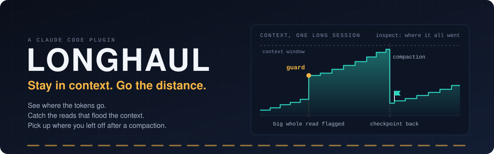
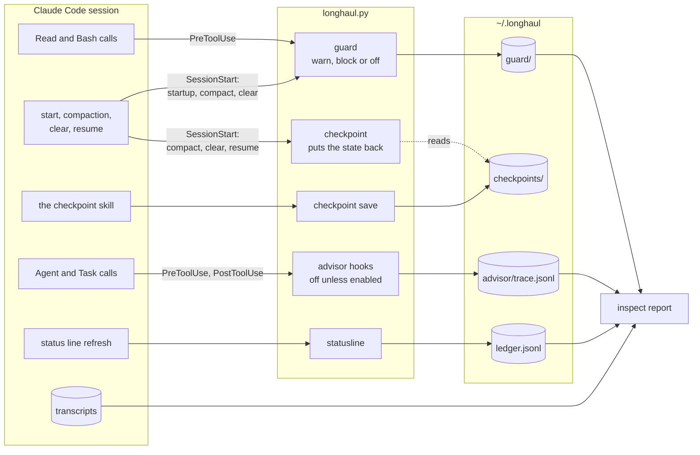

<p align="center">
  
</p>

<p align="center">
  <a href="https://github.com/Noah-OS/longhaul/actions/workflows/tests.yml"></a>
  <a href="https://github.com/Noah-OS/longhaul/releases"></a>
  <a href="#supported-platforms-and-versions"></a>
  <a href="LICENSE"></a>
</p>

<p align="center">
  <a href="#quick-start"><b>Quick start</b></a> &nbsp;·&nbsp;
  <a href="#what-you-get"><b>What you get</b></a> &nbsp;·&nbsp;
  <a href="#how-it-fits-together"><b>How it works</b></a> &nbsp;·&nbsp;
  <a href="#measured"><b>Measured</b></a> &nbsp;·&nbsp;
  <a href="#limitations"><b>Limitations</b></a> &nbsp;·&nbsp;
  <a href="#releases"><b>Releases</b></a>
</p>

**Longhaul** shows where a Claude Code conversation's tokens went, flags the tool calls that put a big file into the context whole or a file the context already holds, and puts the model's own checkpoint back after a compaction or a resume. It is a Claude Code plugin and a terminal command in one Python file (plus a two-file VS Code launcher), standard library only, and what it keeps stays on your machine.

## Why it exists

Long sessions run out of room quietly. A whole `Read` of a big file puts all of it into the context, where every later request carries it until the next compaction; a second whole read of a file that has not changed puts it there twice. Claude Code's own summary at compaction is made when the context is already full. And once a conversation is over, it is hard to say which calls its tokens went to.

Longhaul was built from those patterns as they show up in real use: in one person's 964 transcripts over five weeks, 515 whole-file reads over 20,000 characters, 17.4 million characters in all. It reports the way it asks to be judged: every number names where it came from and how sure it is, and no saving is claimed that has not been measured (see [Measured](#measured): so far, none has been shown).

## What you get

| Feature | What it does |
|---|---|
| **[Usage report](#see-where-your-tokens-go)**<br>`/longhaul:inspect`<br><sub>In the plugin</sub> | Requests and tokens by kind and by model, context growth and compactions, the largest tool outputs, searches, repeated reads, what the guard caught. Each heading names its source and how sure it is. |
| **[Context guard](#the-context-guard)**<br><sub>On, advice only</sub> | Flags a file read again unchanged, and a whole `Read` or bare `cat` of a file over 20,000 bytes. Advice by default; denial is opt-in. |
| **[Checkpoint](#checkpoints-and-recovery)**<br>`/longhaul:checkpoint`<br><sub>In the plugin</sub> | The model saves its goal, next action, decisions and changed files; Longhaul puts them back after a compaction or a resume. |
| **[Status line and ledger](#see-where-your-tokens-go)**<br>`longhaul statusline`<br><sub>Terminal command, set by you</sub> | The account and its 5-hour and 7-day allowance with the reset times; each reading kept for `inspect` and `longhaul usage`. |
| **[Code index](#a-code-index-built-for-you)**<br><sub>Note on; building opt-in</sub> | Tells the model when it finds a CodeGraph index; with `LONGHAUL_INDEX=on`, builds a CodeGraph or Trail-Code map for you. |
| **[Advisor](#the-advisor-experiment-off)**<br>`/longhaul:advise`<br><sub>Experiment, off</sub> | A stronger model reviews the work at four decision points: read-only, capped and traced. |
| **[Across subscriptions](#advanced-experimental-carry-on-across-your-subscriptions-opt-in)**<br>`longhaul`<br><sub>Advanced, experimental, off</sub> | Runs `claude` in your terminal and, at a usage limit, asks before moving the conversation to another of your own subscriptions, or waits for the reset. |

## How it fits together

Six hooks, three skills, one agent and `longhaul.py`. Every hook runs the plugin's own `longhaul.py` with `python3`; what Longhaul keeps goes to `~/.longhaul`; `inspect` reads it back beside the conversation's transcripts.



Every hook fails open but one: whatever goes wrong, the call runs. The one exception is the Advisor's check of a consultation, which denies what it cannot check; and the advisor itself refuses any brief the check did not admit. [What the hooks do](#what-the-hooks-do-and-how-to-turn-them-off) has each hook's matcher, duty and switch.

## Quick start

> [!IMPORTANT]
> A plugin runs code with your privileges, and Longhaul's hooks run in every session once it is enabled. Read [what the hooks do](#what-the-hooks-do-and-how-to-turn-them-off) before you install it.

**1. Install the plugin**, in Claude Code:

```
/plugin marketplace add Noah-OS/longhaul
/plugin install longhaul@longhaul
```

**2. See the report**, in any session:

```
/longhaul:inspect
```

Once the plugin is loaded (the next session, or `/reload-plugins`), the guard runs in warn mode and `/longhaul:checkpoint` saves the state when it is worth keeping.

**3. The status line** (optional) needs the terminal command. Keep a checkout, since the command links to it:

```
git clone https://github.com/Noah-OS/longhaul.git
cd longhaul
python3 longhaul.py setup
```

Then point the status line at it in your own `~/.claude/settings.json`:

```json
"statusLine": {"type": "command", "command": "~/.local/bin/longhaul statusline"}
```

To try the plugin without installing it, run `claude --plugin-dir /path/to/longhaul` from a checkout. [Install](#install) has the details.

## See where your tokens go

- **Inside a session:** `/longhaul:inspect` shows the report for this conversation. `/longhaul:inspect <id>` shows another one.
- **In a terminal:** `longhaul inspect [ID|PATH] [--json]`. Give a conversation's id, a short id that only one conversation starts with, or the path of its transcript; with nothing, it reads the latest conversation the status line recorded (without the status line, give the id). `--json` prints one record per number, with its metric, value, unit, source and confidence, so runs can be compared.
- **The status line:** `longhaul statusline`, which you set in your own `~/.claude/settings.json` (see [Install](#install)), shows the account and how much of its 5-hour and 7-day allowance is used, with the reset times. It also records each reading's context size, cache figures and API-price cost in a ledger that `inspect` reads.
- **The ledger:** `longhaul usage [--days N]` shows it per session and per account, each session named by its `--name` label, or by its project folder and short id, with each account's latest allowance reading first.

The report is read from the conversation's transcript, its subagents' transcripts, the ledger, the guard's record and the Advisor experiment's trace. It holds: requests, main conversation and subagents, per model; tokens by kind, input, cache write, cache read and output, the API's own counts, in all and by model; the context's first, peak and last size, and every compaction; the cache hit ratio from the status line; the five largest tool outputs; calls and output characters per tool; the searches: how many and what share of calls, the longest run of them, the results over 5,000 characters, and whether a CodeGraph or Trail map was seen or called; files read again, and searches repeated, with no edit or compaction in between; what the guard warned about or blocked; the Advisor's consultations, when there were any; tool and API errors. Numbers, model names, tool names and file paths only, never message text or tool output. Each heading names where its numbers came from and how sure they are: measured, counted, inferred or estimated.

An excerpt of a real report, from the session that rewrote this README, early on (some lines left out, paths shortened). The guard's line is the old README, read whole:

```text
Tokens [transcript, measured: the API's own counts]
  Of the requests whose response is in the transcript. Claude Code also makes requests it
  does not write there, so its own totals can be higher.
                   input   cache write    cache read      output
  main                36       109,707     1,684,249      26,014
  subagents            0             0             0           0
  total               36       109,707     1,684,249      26,014
Context, main conversation [transcript, measured: input, cache write and cache read per request]
  first 43,280, peak 133,890, last 133,890 tokens
Largest tool outputs [transcript: characters counted; ≈ tokens estimated as characters / 4]
      51,896 chars   ≈12,974 tokens  Read README.md
      13,310 chars    ≈3,327 tokens  Read test_longhaul.py
Search [transcript, counted: Grep, Glob, and Bash grep, rg, ag, find, fd]
  3 searches, 10% of calls, 7,710 chars
Guard [longhaul guard, counted: calls it warned about or blocked]
  whole read of a big file: 1 (51,108 bytes)
```

And the status line, as `longhaul statusline` prints it for a sample reading (the account in bold, each figure green under 70%, yellow from 70% and red from 90%):

```text
main · 5h 42% (resets 15:43) · week 17% (resets Tue 04:50)
```

## The context guard

The guard runs before every `Read` and every `Bash` call (the hook is described [below](#what-the-hooks-do-and-how-to-turn-them-off)) and catches three kinds of waste:

1. **Read again unchanged:** a file read in full that is already in the context and has not changed since (same size, modification time and change time).
2. **Whole read of a big file:** a `Read` of a file over 20,000 bytes (`LONGHAUL_GUARD_BIG`) with no `offset`, `limit` or `pages`. Images and PDFs are excepted.
3. **`cat` of a big file:** a bare `cat` of such a file. A `cat` with a pipe, a redirect or a chain is left alone: it is filtered, or it is a write.

| Mode | What happens | Set with |
|---|---|---|
| **warn** | The call runs, and the model gets the advice as context, naming the part to read instead. | the default |
| **block** | The call is denied with the same text and "Make the narrower call instead". | `LONGHAUL_GUARD=block` |
| **off** | Nothing. | `LONGHAUL_GUARD=off` |

What the model was told in this README's own session, when it read the old README whole (path shortened):

```text
longhaul guard (advice; the call went ahead): README.md is 51,108 bytes, and a whole Read puts all of it into the context. Read it with offset and limit, or grep -n for the part you need.
```

**Blocking has a price.** A denied read is extra work: the model pages through the file in parts, and each request carries the growing context. On a measured task that needed whole files, block mode cost 3.5 times the baseline's prompt tokens and four times its requests (see [Measured](#measured)). The model always has a way through, because a part read is never checked, so the guard is advice and accounting, not a fence.

A subagent is its own context, so its first read of a file is never a repeat of the main conversation's; after a compaction or a clear the guard forgets what was read and its search count. `inspect` shows what the guard caught, by rule and in bytes. In a project with a CodeGraph index (`.codegraph/` in the project folder or one above it) the guard also tells the model so, once at a new session's start and once more in any context whose count of Bash searches (`grep`, `rg`, `ag`, `find`, `fd`) reaches twenty; it counts searches and never denies one. It never installs a program; with `LONGHAUL_INDEX=on`, where CodeGraph or Trail-Code is installed and the repository has no map, it builds the map for you (see [A code index, built for you](#a-code-index-built-for-you)).

## Checkpoints and recovery

**The checkpoint.** Claude Code's own summary at compaction is made when the context is already full. `/longhaul:checkpoint` has the model save its own structured state at a moment you, or it, choose: the goal, the next action, the decisions, what is done, in progress and blocked, the files changed, and how to verify. Longhaul keeps it private under `~/.longhaul/checkpoints/` and puts it back after a compaction or a resume, with its age and which of the named files changed or went since. It is capped at 1,000 characters per text, 20 entries per list and 8,000 bytes in all, and a save that holds anything shaped like a credential is refused.

A checkpoint is not a copy of the conversation: it is the model's own summary of the state, at most 8,000 bytes, and only what it chose to save. The transcript stays where Claude Code keeps it.

**Recovery, as intended.** Save with `/longhaul:checkpoint` when the state is worth keeping (the model may do it on its own). Then: a compaction, automatic or `/compact`, brings the state back in the same session; `/exit` and later `claude --resume <id>` (or `longhaul -r <id>`) bring it back too, days later included. `/clear` does not: it starts a session with a new id, and the hook looks for that id's checkpoint and finds none; to carry on after a clear, resume the old session by id instead, or save a new checkpoint in the cleared one. A checkpoint is per session id, never per project.

## Measured

Longhaul claims no saving it has not measured. The guard's block mode is being measured against warn mode and off, so far on two repeatable tasks under one loop and one rule.

> [!NOTE]
> **So far, no saving shown.** On a task where the guard had nothing to catch, block mode saved nothing; on a task where it denied reads the task needed, it cost 3.5 times the baseline's prompt tokens and four times its requests. What either mode saves in real sessions is the next measurement (a week of real use counted by `inspect`); until that is in, `warn` stays the default and this README recommends neither `warn` nor `block` over `off`.

<details>
<summary><b>The method</b>, written so that a stranger can run it again</summary>

<br>

The second run says what it changes from the first.

- **The task (first run).** This repository as it was at the run (commit `92ea697` of the private history; the public history starts afresh, so the hash is for the record), with the untracked `docs/` folder on disk, which the public tree does not carry, `git status --short` empty before each run, and this prompt, verbatim: *"Read the code and explain how Longhaul decides whether to move a conversation to another account at a usage limit: which function decides, the three switching modes and which is the default, what `longhaul pipe` and the VS Code panel do where no one can be asked, and which decision record covers that. Name the functions. Do not change any file."* The code at `v0.1.0` is that tree plus this release's changes. It is read-heavy on a module of 176 KB then (195 KB at `v0.1.0`), which is what the guard exists for: a whole `Read` of `longhaul.py` trips "big"; a second whole `Read` of a small file trips "repeat".
- **The quality check (first run).** Five facts, each present in the answer or not: `decide_move()`; ask, auto and never, with ask the default; ask acts as never for `longhaul pipe` and the panel; `--swap` for `longhaul pipe`; the decision record named. A run with fewer facts than the baseline's worst run is a regression. A re-run from this repository replaces the fifth fact, since the decision records are not shipped, with: the mode comes from `--switch`, then `LONGHAUL_SWITCH`, then the default (`switch_mode()`).
- **The configurations.** `LONGHAUL_GUARD=off` (the baseline), `warn` and `block`: five runs each, interleaved (off, warn, block, off, ...) so that the time of day and the provider's cache spread evenly over the three; one model, pinned with `--model opus` (which resolved to `claude-opus-5-5` on the day; Claude Code made its own `claude-haiku-5-5` requests beside it in every run). Nothing else differs.
- **The loop,** run from the checkout, with a scratch folder as `LONGHAUL_HOME` for every run so that `~/.longhaul` is untouched, `PROMPT` set to the prompt above and `MODEL=opus`:

  ```sh
  S=$(mktemp -d)
  for n in 1 2 3 4 5; do for mode in off warn block; do
    LONGHAUL_HOME=$S LONGHAUL_GUARD=$mode claude -p "$PROMPT" --plugin-dir "$PWD" \
      --model "$MODEL" --output-format json \
      --allowedTools "Read,Grep,Glob,Bash(grep:*),Bash(sed:*),Bash(head:*),Bash(cat:*),Bash(wc:*)" \
      > "$S/run-$mode-$n.json"
    sid=$(python3 -I -c 'import json,sys; print(json.load(open(sys.argv[1]))["session_id"])' "$S/run-$mode-$n.json")
    LONGHAUL_HOME=$S python3 longhaul.py inspect --json "$sid" >> "$S/inspect-$mode.jsonl"
  done; done
  ```

  The Bash allowances are deliberate: the model's workarounds must be allowed, or they cannot be measured.
- **What is measured.** Every number comes from `longhaul inspect --json`, per run: input, cache write, cache read and output tokens (main conversation and subagents), requests, the context's peak and last size, the five largest tool outputs, calls and output characters per tool, repeated reads, what the guard fired on and the bytes involved per rule (in block mode that counts denials), tool errors; plus the result's `duration_ms` and the five-fact score by hand. The headline is the prompt tokens carried by the main conversation, input + cache write + cache read, which is what a smaller context lowers. Median and min–max per mode.
- **The rule for the sentence.** A saving is written here only if block's median prompt tokens carried is below off's, every block run scores all five facts, no block run has more requests or tool errors than off's worst run, and the Bash output characters did not rise by what Read fell. Otherwise this section says "no saving shown", with the numbers.

</details>

**The first run** (2026-10-20, commit `92ea697`, `--model opus`, resolved to `claude-opus-5-5`, fifteen runs, every run scoring all five facts):

| mode | prompt tokens carried, median (min–max) | requests, median (min–max) | whole reads the guard caught |
|---|---|---|---|
| off | 373,031 (305,079–500,732) | 7 (6–9) | not checked |
| warn | 429,349 (367,897–614,283) | 8 (7–11) | 0 in 5 runs |
| block | 398,455 (372,466–420,245) | 7 (7–8) | 0 in 5 runs |

**No saving shown.** The three medians sit inside the baseline's own range, and the guard fired on nothing: on this task the model read the module in parts by itself (nine or ten Read calls per run, of up to 16,000 characters, never the whole file) and read each document once, so none of the three rules applied. What this run shows is that any cost of the hooks in tokens is not visible above the run-to-run spread; it does not show what block mode does when the rules fire. The waste the guard was built from is in real sessions, not in this task: in one person's 964 transcripts over five weeks, 515 whole-file reads over 20,000 characters, 17.4 million characters in all. The second run is a task that provokes them.

**The second run** (2026-10-21, commit `4564738`, which is in the public history; the same loop, rule and model): a task that makes the guard fire. The repository state is `longhaul.py` split into four files of up to 1,000 lines (`mkdir bench && split -l 1000 longhaul.py bench/part_`: 45–52 KB each, the last 969 lines, ignored by git), and the prompt, verbatim: *"For each of the four files bench/part_aa, bench/part_ab, bench/part_ac and bench/part_ad, say in three sentences what it holds and name the top-level functions and classes it defines, in order. Read each file. Do not change any file."* Five facts: `pick` is in `part_aa`, `run` in `part_ab`, `guard_check` in `part_ac`, `Relay` and `main` in `part_ad`. The whole read is what the task needs, so this run measures what the guard costs when its rule fires on a read that was wanted.

| mode | prompt tokens carried, median (min–max) | requests, median (min–max) | Read calls / characters, median per run | duration | what the guard caught |
|---|---|---|---|---|---|
| off | 161,416 (161,235–703,237) | 2 (2–7) | 4 / 210,510 | 66–81 s | not checked |
| warn | 288,561 (161,770–580,419) | 3 (2–6) | 4 / 210,510 | 47–66 s | "big" fired 4 times per run |
| block | 561,981 (379,216–686,639) | 8 (8–12) | 12 / 211,479 | 83–145 s | 4 denials per run |

**No saving shown, and a cost shown when the whole file is wanted.** Every run scored all five facts, with no tool errors. In block mode the four whole reads were denied and the model paged the same four files through twelve part-reads, each request carrying the growing context: 3.5 times the baseline's median prompt tokens, four times its requests, and longer; every block run made more requests than the baseline's worst, which on its own rules a saving out under the rule above. Read characters did not fall (211,479 against 210,510); they moved from whole reads into parts. The baseline's one high run (703,237 tokens, 7 requests) read with Bash `sed` and `cat` and read again; the other four were at 161,000, below every block run. Warn mode's advice sometimes sent the model back to verify: a median 1.8 times the baseline's, two runs at the baseline's level and two far above. So far, then: on a task where the guard had nothing to catch, block mode saved nothing; on a task where it caught reads the task needed, it cost 3.5 times the tokens and four times the requests.

## Install

You need Claude Code (`claude`) and `python3` on your PATH. Longhaul is one Python file with no dependencies; nothing is pip-installed. A plugin runs code with your privileges, so read `hooks/hooks.json`, `bin/longhaul`, the three `skills/*/SKILL.md`, `agents/advisor.md` and `longhaul.py` before you install it; with `LONGHAUL_INDEX=on` and CodeGraph or Trail-Code installed it also runs their init in the repositories you open, and Trail's init writes a SessionStart hook into the repository's `.claude/settings.json`, which, committed, runs for everyone who opens a clone (see [A code index, built for you](#a-code-index-built-for-you)).

**The plugin** installs with the two commands in [Quick start](#quick-start), or runs without installing from a checkout with `claude --plugin-dir /path/to/longhaul`. In a session, `/plugin install` opens the plugin's details so you can review it and choose a scope; it does not install outright. The marketplace add needs `git` on your machine; it writes the marketplace to `extraKnownMarketplaces` in your `~/.claude/settings.json` and to Claude Code's own `~/.claude/plugins/` records, and installing records the plugin as enabled there too: Claude Code's own steps, not Longhaul's. The plugin gives you `/longhaul:inspect`, `/longhaul:checkpoint`, `/longhaul:advise` (the Advisor experiment's skill, off unless turned on), the hooks, and `bin/longhaul`, which the skills run by its full path and which runs only `inspect`, `usage`, `status`, `advisor status`, `checkpoint save` and `-h` from inside a session and refuses the rest. A plugin cannot set the status line or put `longhaul` on your terminal's PATH, and its folder changes at every update, so the terminal command is a second install. Each release bumps the version in both `plugin.json` and `marketplace.json` (a test keeps them equal): users on a cached copy get an update only when the string changes.

**The terminal command**, for the status line and the advanced feature: `python3 longhaul.py setup`, run in a checkout you keep, links `~/.local/bin/longhaul` to that checkout, never to the plugin cache (it refuses to). With no second subscription on the list that is all it does. The status line is then yours to set, in your own `~/.claude/settings.json`, as [Quick start](#quick-start) shows: your edit, not Longhaul's.

Python 3.10 or later. The tests are under [Development](#development).

## What the hooks do, and how to turn them off

`hooks/hooks.json` registers six hooks. Each runs the plugin's own `longhaul.py` with `python3`, has a 5-second timeout (the Advisor's check of a consultation has 30 seconds), and shows a status message while it runs.

| Hook | When | What it does |
|---|---|---|
| `PreToolUse` on `Read` and `Bash` | before every `Read` and every `Bash` call | `longhaul guard`. Reads the call from the hook's JSON on stdin: the tool, a `Read`'s file path and whether it is a part, or a `Bash` command's first program and, when it is `cat`, its file arguments. Checks each file's size and change times against the session's record and answers with advice (warn), a denial (block), or nothing. When the program is a search (`grep`, `rg`, `ag`, `find`, `fd`) it counts the search for this context and, when that count reaches twenty, names the project's CodeGraph index if there is one (one note per context); a search is never denied. Writes `~/.longhaul/guard/<session>.json` (a subagent's record is `<session>+<agent>.json`). The command line itself is never kept. Status message: "Checking this call (longhaul guard)". |
| `SessionStart` on `compact` and `clear` | after a compaction or a clear | `longhaul guard` again: empties the record's list of reads and its search count, since nothing read before is in the context now and the new context has made no searches, and keeps the per-rule counts. "Forgetting this session's reads (longhaul guard)". |
| `SessionStart` on `startup` | when a new session starts (not at a resume, a clear or a fork) | `longhaul guard` a third time: when the project folder, or one above it, holds a CodeGraph index (`.codegraph/`), puts one note into the main conversation's context naming `codegraph explore` and the `codegraph_explore` tool for symbol and dependency questions and leaving `grep` and `rg` for plain text; without the index, nothing of that. With `LONGHAUL_INDEX=on`, where `codegraph` or `trail` is on the PATH and the repository has no map, starts that program's init in the background and says so in one sentence (see A code index, built for you). Writes at most one log line and, for each init it starts, the state file under `~/.longhaul/index/` and one more log line. "Looking for a code index (longhaul guard)". |
| `SessionStart` on `compact`, `clear` and `resume` | after a compaction, a clear or a resume | `longhaul checkpoint`: reads `~/.longhaul/checkpoints/<session>.json` if there is one and puts its text back into the context, with its age and which of the files it names changed since. Writes nothing but one log line. "Looking for a checkpoint (longhaul checkpoint)". |
| `PreToolUse` on `Agent`, `Task`, `SendMessage` and `Workflow` | before every subagent call, every message to a subagent and every workflow | `longhaul advisor-hook`, the Advisor experiment's check (off unless you turn it on). It answers a call of the `longhaul:advisor` agent type, or a bare `advisor`: that is a consultation. It denies it, with a reason the model can act on, unless every check in [The Advisor experiment](#the-advisor-experiment-off) holds. Admitted, it sets the subagent's model and adds a one-time admission line above the brief; the call it passes on holds only the fields it knows. It also denies three other calls: a brief sent to any other agent type (a stand-in), a workflow that names the advisor, and a message to an advisor that has already answered (a follow-up). Unlike the other hooks it fails closed: a consultation it cannot finish checking is denied, and if Longhaul itself cannot load, the hook's own few lines deny a consultation anyway. Any other call gets no answer and nothing is written, unless its input is over 1 MB. The hook reads only the first 1 MB, and the rest could name the advisor, so such a call is denied whatever its type; no real call is that large. Writes `~/.longhaul/advisor/state.json` (counts, brief hashes, the admitted calls) and a line in `trace.jsonl` (sizes, hashes, the trigger, the decision), never the brief's text. "Checking for an advisor consultation (longhaul advisor)". |
| `PostToolUse` on `Agent`, `Task`, `SendMessage` and `Workflow` | after every subagent call, every message to a subagent and every workflow | `longhaul advisor-result`: for a consultation alone, one line in `~/.longhaul/advisor/trace.jsonl` with the reply's verdict, confidence and size, how long it took and the model the advisor ran on (read from its own transcript), never its text. An advisor that ran without an admission is traced as `unadmitted`. One that ran on another model than the one decided, or on a model the hook cannot tell, stops consultations for the rest of the session. Nothing for any other call. "Tracing an advisor consultation (longhaul advisor)". |

Every hook but the Advisor's check of a consultation fails open. Whatever goes wrong, it prints nothing, writes at most a line per record to `~/.longhaul/longhaul.log`, and exits 0. Claude Code lets a call run on any exit but 2 and when a hook overruns its timeout, so a guard never stops a call it did not mean to stop, and a session start is never stopped by its checkpoint. Measured warm on one Mac, the guard takes 87–94 ms per call, and it runs once more at each new session's start. Once the plugin is enabled its hooks run in every session of every project; Claude Code has no switch per hook.

Without `python3` on PATH the hooks cannot start; Claude Code then shows its own hook-error notice with the first line of stderr, lets the call run, and the skills' shell steps stop the skill with the shim's message.

- **The guard off:** `LONGHAUL_GUARD=off` in the environment Claude Code starts with; it turns off the guard's rules in all three of its hooks, the startup note and the search count with them; the startup hook's other duty, the index (next bullet), is not its to turn off. `warn` is the default; `block` denies. The deny text never names the off switch: that is for you, not the model.
- **The index on:** `LONGHAUL_INDEX=on` where Claude Code gets its environment: an `export` in your shell profile for the terminal; for the desktop app and VS Code, which do not take exports from your profile, `"env": {"LONGHAUL_INDEX": "on"}` in your own `~/.claude/settings.json` (the same route works for `LONGHAUL_GUARD`). Off unless you set it. `LONGHAUL_GUARD` does not touch it: the two switches are separate.
- **The checkpoint hook** has no switch of its own. Disabling the plugin turns all six hooks off together: `/plugin`, the Installed tab, select Longhaul, Disable plugin; or `claude plugin disable longhaul@longhaul` in a shell; it applies at `/reload-plugins` or the next session.

## A code index, built for you

Off unless you turn it on with `LONGHAUL_INDEX=on` in the environment Claude Code starts with. Then, if `codegraph` or `trail` is on that PATH, and executable, the startup hook builds that program's map for the repository you open when it has none: `codegraph init -y` when no `.codegraph/` is at the project folder or above it; `trail init --yes --no-global --no-statusline --no-agents` when no `.trail/` is. Both run when both programs are installed and both maps are missing. The init runs in the repository's top level (the nearest folder with a `.git`), in the background, detached from the hook, so the session is usable at once; you are told in one line that the init started and where its log is, and the model in one sentence that the map is for later sessions and to search as it would without one; the next session finds the map; for CodeGraph the guard's index note and nudge then take over, for Trail its own hook speaks.

It runs once per repository: `~/.longhaul/index/<key>.json` records the start, the process id and the exit; a run in progress is not started twice; a failed or interrupted one is retried after 24 hours, and a half-built map of its own making is rebuilt then, whatever the folder shows, while a map it did not make is never touched. If you rebuild a map by hand after a failure, delete the state file: the map is then yours, never touched, and the guard names it. (Running an init again over a good map does no harm either: CodeGraph rebuilds it, and Trail's init merges its settings.) A map that goes after a good build (a `git clean`, a fresh clone at the same path) is rebuilt at the next session's start. To retry a failure sooner, delete that state file and the half-built map folder together: a map folder with no state entry of Longhaul's is taken as someone else's and never touched, so deleting the state file alone does nothing. A run is bounded at 600 seconds (`LONGHAUL_INDEX_TIMEOUT`); past it the program and its child processes are killed, and that is not retried on its own, since a repository that needs longer will need longer tomorrow: on a large repository (CodeGraph's own figure is 100 s for 27,000 files) run the init by hand once, or raise the bound. A failure that stands is said to you once more at each later session's start, with its day, its reason, its log and how to retry. The program's own output goes to `~/.longhaul/index/<key>.<program>.log` and never into the conversation or Longhaul's log. The program gets the environment Claude Code started with, minus the session's own Claude variables (its id, its process id, its messaging socket and token, and the like); your telemetry settings pass through untouched.

It never runs:

- without `LONGHAUL_INDEX=on`;
- in your home folder, a parent of it, or the root;
- outside a git work tree;
- for a subagent;
- at a resume, a compaction or a clear (the hook acts at a new session's start only);
- in an unattended run (`claude -p`, which starts its hooks with `CLAUDE_CODE_SESSION_ATTENDED=0`, seen on Claude Code 2.1.304; the variable is not documented, and the desktop app and VS Code are not yet checked; the one refusal that writes a log line, so a "why not" is cheap to answer);
- for a program found through a relative PATH entry or inside the repository itself;
- where the map already exists, including one a repository ships.

<details>
<summary><b>What each program writes</b>, and which of it was measured</summary>

<br>

`codegraph init -y`, measured on a clone of this repository on 2026-10-21: `.codegraph/` (3.6 MB, with its own `.gitignore`, so `git status` stays clean) in 3.6 s, nothing else, no process left. `trail init --yes --no-global --no-statusline --no-agents` has not been run here as written. Measured on 2026-10-21 (Trail-Code 0.23.1) without `--no-agents` and with `--no-build`, it wrote, in the repository, `.claude/settings.json` (a SessionStart hook, meant to be committed for your team), `.claude/settings.local.json` (hooks on edits, tool calls and prompts) and `.trail/` (its hooks and its map's cache, which Trail git-ignores; its learnings go there later), plus the other agents' files that `--no-agents` skips by Trail's description of the flag ("Claude Code wiring only"); on the machine, `~/.trail/`, despite `--no-global`. That init took 0.4 s and a separate `trail build` 1.2 s (3.4 MB under `.trail/cache/`); the form Longhaul runs builds inside the init and has not been timed. In an ordinary repository `git status` then shows `.claude/` and `.trail/` as untracked; the hook file is meant to be committed, the local file and `.trail/cache/` not; what Trail's init does to a `.claude/settings.json` the repository already has is not measured. In those runs neither program changed `CLAUDE.md`, `~/.claude/settings.json` or `~/.claude.json`. Telemetry is each program's own and Longhaul never sets it: CodeGraph keeps your saved choice; Trail's is on by default with a daily flush, off with `trail telemetry disable` or `DO_NOT_TRACK=1`. Longhaul never installs either program.

</details>

## The Advisor experiment (off)

An experiment, off unless you turn it on, and built to be measured before it is trusted. When on, the model doing your task (the executor) may ask a stronger model for an independent review at four decision points: early, before the first write on a multi-file, architectural or unclear task; when stuck; before changing approach; and before declaring a long task done. It does so through `/longhaul:advise`, which writes a short brief and calls Longhaul's read-only `advisor` agent; the advisor may Read, Grep and Glob the repository and nothing else, answers in a fixed shape (`Verdict: proceed | adjust | stop`, why, risks, the next step, its confidence) in at most 300 words, and changes nothing. The executor weighs the advice, stays responsible for the work, pauses and asks you on `stop`, and tells you in one line after each consultation.

A hook checks every consultation before it runs. It denies the consultation, with a reason the executor can act on, unless all of these hold:

- the switch is on and you have enabled it from a terminal;
- Longhaul's folder is an absolute path outside the repository, so a repository's settings cannot supply a probe record or a key of their own;
- a capability probe has passed on the Claude Code version running, read from the session's own transcript. The record is `~/.longhaul/advisor/probe.json`. It has passed on 2.1.307 only, so any other version, an update included, is refused until a probe passes there;
- the executor's model has a stronger advisor. Haiku and Sonnet get Opus, Opus gets Fable, and an unavailable advisor is never replaced by another;
- that advisor model's switch has been seen working by the probe;
- no Claude Code setting forces the subagent's model: `CLAUDE_CODE_SUBAGENT_MODEL`, `CLAUDE_CODE_SUBAGENT_MODEL_FORCE` and `CLAUDE_CODE_COORDINATOR_FORCE_WORKER_INHERIT_MODEL` are all unset;
- the account may be used in this repository, by the restrictions in this Longhaul folder and in `~/.longhaul` both;
- the call holds no field the hook does not know, and does not ask to run in the background;
- the brief is at most 8,000 characters, in its fixed lines, with no credential in it;
- the task is known;
- the caps hold. With Opus as advisor, that is 2 per task plus 1 reconcile call, and 6 per session. With Fable, it is 1 plus 1, and 3. The two advisors are counted apart, and the same brief twice is refused;
- the account's 5-hour window is not nearly full, by a fresh status-line reading.

Anything the hook cannot check, it denies. An admitted brief carries a one-time admission line, and the advisor refuses a brief without one, so a consultation the hook never saw gets no answer. The consultation runs in the same session, on the same account and model provider as everything else: no new credential and no new data path. Each attempt is one line in `~/.longhaul/advisor/trace.jsonl` (times, the trigger, the models, the decision and its reason, sizes and a hash of the brief, the verdict; never the brief's or the reply's text), kept 30 days and at most 2,000 lines, and `/longhaul:inspect` shows a conversation's consultations and their tokens.

**Off by default.** It takes three things to turn it on:

1. A passing probe record for your Claude Code version.
2. `longhaul advisor enable`, run by you in a terminal. It is refused inside a Claude Code session, and refused without a terminal for `~/.longhaul`. It writes `advisor/enabled.json` for the probe record's version, so a new version needs a new enable.
3. `LONGHAUL_ADVISOR=experiment`, where Claude Code gets its environment (as for `LONGHAUL_INDEX`).

Turning it off takes either of these:

- `longhaul advisor disable`, which always works;
- unsetting the switch.

`longhaul advisor status` says whether it is on and why not. Its value is not measured yet: a benchmark against runs without it is built and waits.

## Privacy and what is written where

- **On your machine.** Everything Longhaul keeps is under `~/.longhaul` (or the folder `LONGHAUL_HOME` names), in files readable by you alone, with the few exceptions the table below names.
- **Numbers, not text.** The report, the guard's record, the ledger and the log hold numbers, ids, account, model and tool names, file paths and Longhaul's own lines; never message text, tool output or a credential. (The log names the email an account is signed in as when it is the wrong one.) Nothing but the checkpoint file, and the skill's state file until the save takes it, holds the model's text, on purpose. The index logs hold the programs' own output, never the conversation.
- **Nothing sent.** Longhaul has no telemetry. The one network connection it opens itself is the supervisor's check that `api.anthropic.com` answers on port 443, before it reopens a conversation whose Remote Control link was lost: opened and closed, nothing sent. The programs it starts (`claude`, and with `LONGHAUL_INDEX=on` CodeGraph or Trail-Code) have their own network behaviour.
- **Not a security boundary.** The hooks are advice and accounting. The guard checks a whole `Read` and a bare `cat`; a part read, a pipe, `head` or `sed` pass it, and a hook that fails, overruns or cannot start lets the call run. Read the plugin's files before you install it (see [Install](#install)).

<details>
<summary><b>Every file Longhaul writes</b>, what it holds and what writes it</summary>

<br>

Everything Longhaul keeps is under `~/.longhaul` (or the folder `LONGHAUL_HOME` names). The files it writes are readable by you alone (mode 0600), except the empty lock files and the skill's `<session>.state.json`, which the Write tool makes with your default mode and the save removes once it has read it.

| File | Holds | Written by |
|---|---|---|
| `guard/<session>.json`, `guard/<session>+<agent>.json` | the files read in full (path, size, change times, when), per rule how often the guard fired and how many bytes were involved, the context's search count and whether it was told of a code index; never a command line, a search pattern or a file's text | the guard hook |
| `checkpoints/<session>.json` | the model's own summary of the conversation, on purpose: goal, next action, decisions, done, in progress, blocked, changed files, verification; 0600, read by the checkpoint hook alone | `/longhaul:checkpoint`, through `longhaul checkpoint save` |
| `checkpoints/<session>.state.json` | the same state as the model wrote it, before the save checks it; made by the Write tool with your default file mode; removed as soon as the save has read it, whether it saved or refused | the model, through `/longhaul:checkpoint` |
| `ledger.jsonl` (and `.1` once it is moved aside at 10 MB) | one row each time a status-line reading moves: time, session id, account, API-price cost, the 5-hour and 7-day allowance used, the 5-hour reset time, context size, model id, cache hit ratio, misses and re-cached tokens, the API time of the reading and, from the panel, the claude process id | the status line (and the panel wrapper and `longhaul pipe`, which record a chat's usage the same way) |
| `usage/<account>.json` | the latest allowance reading per account | the status line (and the panel wrapper and `longhaul pipe`, which record a chat's usage the same way) |
| `usage/sessions/<session>.json` | a conversation's last row, the path of its transcript, and the account it last ran on, which a resume reads in ask and never | the status line, the panel wrapper and `longhaul pipe`; the supervisor notes the account at the end of each launch (and the panel wrapper for a chat reopened by id) |
| `index/<key>.json`, `index/<key>.<program>.log` | per repository (`<key>` is its folder name and a hash of its path): which init was started, when, its process id and exit; and that program's own output | the startup hook and the init it starts |
| `advisor/probe.json`, `advisor/enabled.json`, `advisor/state.json`, `advisor/trace.jsonl`, `advisor/version-cache.json` | the Advisor experiment's gate (the Claude Code version a capability probe passed on, and the advisor models whose switch it saw), your key that turns it on for that version, its per-session and per-task counts, brief hashes and admitted calls, one line per consultation attempt (never a brief's or a reply's text), and the version read from the binary when a transcript gives none | `longhaul advisor record-probe`; `longhaul advisor enable` and `disable`; the advisor hooks |
| `longhaul.log` (and `.1` at 5 MB) | what Longhaul did and why, one line each: sessions, sizes, reasons; never message text | every command and hook |
| `labels.json` | the name you gave a session with `--name` | the supervisor and `longhaul pipe --name` |
| `accounts.json`, `state.json`, `auth-cache.json`, `locks/<session>.lock` | the advanced feature's accounts (name, folder, email, and the repositories it may be used in, if restricted); the recorded limits and the limit stops already acted on; per account folder, the email `claude auth status` last reported and when (kept 120 s, `LONGHAUL_AUTH_TTL`); the supervisor's empty per-conversation lock files | `longhaul add` and `remove`; the supervisor, `longhaul pipe`, the panel wrapper and `longhaul clear`; the panel wrapper and `longhaul pipe` (an entry goes at `setup`, `remove` or a sign-in made in a panel chat); the supervisor |
| `.guard.lock`, `.index.lock`, `.state.lock`, `.folders.lock`, `.auth.lock`, `.accounts.lock`, `.<file>-move.lock` | nothing: empty files the OS locks so that one writer at a time updates a record | the guard hook; the index's hook and runner; the log and the ledger when they move aside; the advanced feature |

`vscode.json` is yours: Longhaul reads it and never writes it.

</details>

**The checkpoint's cost:** the whole of it is put back into the context at every compaction and resume, up to about 2,500 tokens each time (the text is kept under 10,000 characters), however stale it is. Save a new one when the state has moved on, and keep it short.

Longhaul never edits `~/.claude/settings.json` or `~/.claude.json`. Two things touch them, and both are yours: installing the plugin, Claude Code's own step, which records the plugin as enabled in your settings; and the status line, which you point at `longhaul statusline` in your own settings. The advanced feature writes elsewhere, and its section says where. Its one exception is the promotion that section describes: a `settings.json`, `keybindings.json` or `CLAUDE.md` you changed in a chat on another account becomes the shared file, and the one before is kept beside it.

## Advanced, experimental: carry on across your subscriptions (opt-in)

> [!WARNING]
> Off unless you turn it on, and experimental: the supervisor's behaviour at a real usage limit, after a real crash and across a real account change has been exercised against a fake Claude and in short live checks, not yet end to end on real sessions (see [Limitations](#limitations)). It moves one person's own conversation between that person's own subscriptions, never an account between people; read your subscriptions' terms and decide for yourself.

If you have more than one Claude subscription, `longhaul`, the terminal command, not the plugin, runs `claude` in your terminal with Remote Control on and watches it. At a usage limit it closes Claude, and then:

- `--switch ask`, the default: it asks in that terminal whether to move the conversation to the other account. On `y` it reopens the conversation there with a "carry on" message; with no yes it waits for the reset and carries on where it was.
- `--switch auto`: it moves without asking, and early when an account is nearly full and Claude is idle.
- `--switch never`: it always waits for the reset.

`LONGHAUL_SWITCH` sets the mode without the flag. Where no one can be asked, ask acts as never: `longhaul pipe` (another program driving `claude` over stream-json) moves a session only when the driver passes `--swap` and the mode is `auto` (`--switch auto` before `--`, or `LONGHAUL_SWITCH=auto`); the VS Code panel, through the `longhaul-vscode` process wrapper, moves a chat only with `switch_mid_session` true and `"switch": "auto"` in `~/.longhaul/vscode.json` (or `LONGHAUL_SWITCH=auto` in the environment VS Code starts with). Nothing moves without an explicit auto.

A conversation resumed by id (`longhaul -r ID`, a resumed `longhaul pipe` session, a panel chat reopened by id) starts on the account it last ran on in ask and never, unless `--account` names another; with no record of where it ran, or in auto, Longhaul picks. The record is the session's file under `usage/sessions/`, which the status line, the panel wrapper, `longhaul pipe` and the supervisor itself (at the end of each launch) keep, so a terminal session without the status line is remembered too; a panel chat that was new keeps its place once the status line or the relay has recorded it. In `longhaul pipe` and the panel the last account is used only if it is still signed in as its email (and, for pipe, managed); otherwise Longhaul picks as before. If that account is at its limit, `longhaul -r` waits for its reset, or start it with `--account`; the panel, which has no `--account`, sends a notification that the chat stays on the account at its limit. Longhaul also reopens the conversation after a crash, with a countdown that grows each time, and when a Remote Control link stays lost, and gives up after a few.

### Setting it up

Each account needs its own folder with its own sign-in. `longhaul add NAME EMAIL` makes the folder (`~/.claude-<name>`, lower-cased: `~/.claude-pro` for `Pro`), signs it in once in the browser, and accepts only that email for it from then on. `longhaul setup [NAME]` signs in again any account that is not signed in as its email, and links `~/.local/bin/longhaul` so that `longhaul` works from any folder. `longhaul status` shows the accounts, who each is signed in as, the recorded limits, the links, the Claude Code version check and the switching mode in force. Then `longhaul` for a new conversation, `longhaul -c` to continue the latest, `longhaul -r [ID]` to resume one, `longhaul --account Pro` to start on an account; anything after `--` goes to `claude` on every launch. `longhaul -h` lists the rest.

### Restricting an account to repositories

`longhaul add NAME EMAIL --repo ~/work/repo` (repeat `--repo` for more), or add `"repositories": ["~/work/repo"]` to that account in `~/.longhaul/accounts.json` by hand. An account with the list is used only in those repositories and the ones inside them, compared by real path: a symlink to one counts, a symlinked folder inside one that leads elsewhere does not. Outside them Longhaul never starts, resumes or moves a conversation on it, whatever `--account` or the session's record says: `--account` naming it there is refused with exit 2 and one line; a conversation that last ran on it is picked up on an allowed account, and Longhaul says so; with no account allowed it stops before starting Claude with one line naming the folder and each account's list (exit 1), and the VS Code panel refuses the chat with a notification instead of running Claude unchanged. A value that is not a list of absolute paths allows the account nowhere, and `longhaul status` says so. An account without the list is unrestricted, as before. `longhaul status` shows each restricted account's list. The repository is the folder Longhaul runs in, taken up to the nearest folder with a `.git`. The log names the account and the repository, never an email it did not name before.

### What it writes outside `~/.longhaul`

The plugin writes none of this:

- `~/.claude-<name>/`, one folder per account you add (mode 0700), holding that account's sign-in and its own `.claude.json`. Inside it, links to `~/.claude`'s `projects`, `sessions`, `file-history`, `history.jsonl`, `plans`, `plugins`, `skills`, `agents`, `commands`, `settings.json`, `keybindings.json`, `CLAUDE.md`, `ide` and `todos`, so that every account sees one history, memory and setup. Claude Code keys each account's Keychain entry to its folder.
- The account's own `.claude.json`: at setup, some keys are copied once from `~/.claude.json` (MCP servers, project trust, onboarding done, install method, auto-update, theme; never the sign-in), and before each launch any MCP server `~/.claude.json` has and the account lacks is copied across.
- `~/.local/bin/longhaul`, a link to the checkout's `longhaul.py`.
- If Claude Code saves a linked file as a separate copy under an account, Longhaul puts the link back at the next launch and keeps the copy beside it. For `settings.json`, `keybindings.json` and `CLAUDE.md`, a copy newer than the shared file is your latest edit, made in a chat on that account, and becomes the shared one, with the older kept as `settings.json.before-<account>-<stamp>`. It says so each time.

## Supported platforms and versions

- **macOS**, where Longhaul was built and checked. The supervisor uses macOS pieces: notifications through `osascript`, `caffeinate` to keep the Mac awake while it runs, and the Keychain entry Claude Code keys to each account's folder.
- **Linux:** the suite passes in CI (Ubuntu, Python 3.10 and the latest 3.x, from the first release on); not used in anger.
- **Claude Code.** The supervisor reads files Claude Code writes but does not document (the running process's `sessions/<pid>.json` and the conversation's transcript); it has been checked on 2.1.295 to 2.1.303. On a newer version `longhaul` says it "has not been checked" until it has seen a real limit there: Claude runs as normal, and if Longhaul does not switch accounts at a limit, that is why. The hooks, the shim and the skills were built against 2.1.304.
- **Python 3.10 or later**, the oldest CI runs the suite on; standard library only; nothing is pip-installed. `python3` must be on PATH: the hooks and the plugin's `bin/longhaul` run it by name. Without it the hooks fail open (nothing is checked, nothing is put back) and the shim, which the skills run, stops with one line that says to install it (`xcode-select --install` or `brew install python` on a Mac).
- **Where the plugin loads:** the terminal, the desktop app and VS Code. claude.ai and Cowork do not install a plugin that has a `bin/` folder, and Longhaul has one.

## Limitations

- The guard checks a whole `Read` and a bare `cat`. A `Read` with `offset`, `limit` or `pages` is a part and is never checked, so a `limit` as large as the file gets past block mode; `inspect`'s "Read again" still counts the repeated call. A `cat` with a pipe, a redirect or a chain is left alone, and `head`/`sed` dumps are not covered: counted over 964 transcripts, 14 large-range `sed -n` dumps against 68 big `cat` results and 515 big whole-file Reads, so not worth a rule.
- Block mode has shown no saving in the two measured runs and, on a task that needs whole files, a cost of 3.5 times the baseline's prompt tokens (see [Measured](#measured)); do not turn it on for a saving today. On that task warn mode's advice had a cost of its own. What either saves in real sessions is being counted.
- `inspect`'s "Read again" and "same search again" do not see files changed through Bash (`sed -i`, a `git checkout`, a build), so a read after such a change can be counted as a repeat.
- A relative path in a `cat` is resolved against the working directory the hook is given; whether that follows a `cd` in the Bash tool is not yet checked.
- `/clear` gives the session a new id (seen live), so the checkpoint does not come back after a clear: the hook runs and finds no file. It comes back after a compaction and a resume.
- The checkpoint is put back whole and however old it is, up to about 2,500 tokens each time (the text is kept under 10,000 characters).
- The hooks add 87–94 ms to every `Read` and `Bash` call, measured warm on one Mac, and one run of the guard at each new session's start (with `LONGHAUL_INDEX=on` it also walks up to the nearest `.git` and looks for `codegraph` and `trail` on the PATH).
- A code map is looked for in the project folder and every folder above it, up to the root, so a folder of the same name in your home folder counts. CodeGraph keeps its own files in `~/.codegraph/`, and Trail-Code's init writes `~/.trail/`: on a machine where either has run, every project under your home folder is taken as mapped. The guard's startup note then names a CodeGraph index that is not there and `inspect` reports a map at or above the folder (both seen on 2026-10-22), and `LONGHAUL_INDEX=on` builds no map under your home folder (read from the code: the folder found is taken for someone else's map).
- The Advisor experiment's two hooks run on every subagent call and every message to a subagent, about 0.1 s each, even with the experiment off.
- A check that overruns its 30 seconds, or cannot start at all (no `python3`, hooks turned off), lets the call run, by Claude Code's design. The advisor then refuses for want of an admission line. That refusal is the agent following its own instructions, not code. It runs on the executor's model and is traced as `unadmitted` when the result hook runs.
- A workflow that builds the advisor's name while it runs, rather than naming it, is not seen by the hook. Only the advisor's own refusal stops it. The Workflow tool's hook input has not been probed.
- An executor that sets out to get around the check could do so. It could write under `~/.longhaul` with its own tools, or forge an admission line while every hook is down. Nothing guards those files against the session's own writes.
- The experiment has been probed on Claude Code 2.1.307 only, with Opus and Fable as advisors, and its value is unmeasured.
- The index built for you has been seen live once, with CodeGraph on one Mac (Claude Code 2.1.306, 2026-10-22: the init started at a new session, exit 0 after 6.2 s, `git status` clean, nothing left running); Trail's init as Longhaul runs it has not been seen live; a repository that ships a `.codegraph/` or `.trail/` folder is taken as mapped, whatever its hooks do; a program is found only on the PATH Claude Code was started with (the desktop app reads your shell profile for PATH, so one installed through nvm is found there when nvm's setup is in the profile); not checked in the desktop app or VS Code, nor on Linux.
- The advanced feature: the question at a real limit has been seen only against a fake Claude; Claude Code 2.1.304 is untested at a limit; `ask` asks nobody in `longhaul pipe` or the VS Code panel, so there the conversation stays where it is; a real crash's exit code has not been observed; a resumed conversation's return to its last account has been seen only against the fake Claude; the lock files in `locks/` stay (empty; the OS releases the lock).

## Pairs well with CodeGraph and Trail-Code

**[CodeGraph](https://github.com/colbymchenry/codegraph)** is a local code index (MIT) that builds a symbol and dependency graph of a repository in SQLite under `.codegraph/` and exposes one MCP tool, `codegraph_explore`, and a CLI, `codegraph explore`, so that a question like "how does X decide Y" is answered in one call with the symbols' source and the call paths between them, instead of a grep-then-read loop. Its README reports 88% fewer tool calls and 62% fewer tokens on architecture questions over seven repositories, the median of four runs each: self-reported, not independently replicated. Its README also gives the counterweight: an answer leaves about 80% more retrieval context resident by the end of a session (67k against 18k tokens on one repository), so it moves cost as well as cutting it, and a long session should budget for that.

<details>
<summary><b>Measured here once:</b> no saving shown on one question, and a cost shown</summary>

<br>

2026-10-21, hooks at `46f599f`, clones at `4564738`: ten `claude -p` runs with `--model opus`, five in a plain clone of this repository and five in a clone with a CodeGraph index, interleaved, the indexed runs allowed the `codegraph_explore` tool, the question *"Which functions in longhaul.py call `write_json`, and which of those run inside a plugin hook? Name each caller and say whether it runs in a hook. Do not change any file."*, five callers to name. Every run named all five. With the index the model made 3 searches per run against 4 without (medians; 2–4 against 2–8), and carried 638,548 prompt tokens against 288,931 (medians; every indexed run above every plain run), in 11 requests against 6, with a context peak of 78,583 tokens against 62,426. In every indexed run the model first tried the `codegraph` CLI, which the run's tool list denied, then called `codegraph_explore` up to four times at 10–16 KB an answer, and in four of the five runs read the 17 KB output of CodeGraph's own prompt hook, which its installer had put in this machine's settings. No saving shown on this question, and a cost shown; the figures above stay self-reported.

</details>

Longhaul's part is to show whether an index would help: `/longhaul:inspect` counts the calls per tool, the searches repeated with nothing changed in between and the files read again, so you can see how search-heavy a session was before you add one. A search in that count is a Grep or Glob call, or a Bash `grep`, `rg`, `ag`, `find` or `fd` (`git grep` is not counted: by the program alone it cannot be told from `git log`). When a conversation made 20 or more searches and no index was seen (no `.codegraph/` or `.trail/` folder at or above the project folder, and no `codegraph` or `trail` call), the report's Search section says so and names the install: `npm i -g @colbymchenry/codegraph` (or `curl -fsSL https://raw.githubusercontent.com/colbymchenry/codegraph/main/install.sh | sh`), then `codegraph init` in the project. Where the index exists, the guard says so to the model rather than to you: once at a new session's start, and once more to any context, the main conversation or a subagent, whose count of Bash searches reaches twenty, naming `codegraph explore` and the `codegraph_explore` tool for symbol and dependency questions and leaving `grep` and `rg` for plain text; it is context, never a denial (the hooks table above). CodeGraph's own installer may write a section into your instructions file, sets up permissions and a prompt hook for its tools in Claude Code unless told not to, and asks you about telemetry up front.

**[Trail-Code](https://github.com/trailhq/Trail-Code)** (formerly Graft, MIT) is the other map Longhaul knows: a tree-sitter index of files, functions and calls, plus "learnings", decisions saved from your conversations as files under `.trail/` and committed for your team. Its README reports 46% fewer tool calls over 162 runs and 33 of 50 SWE-bench issues solved against 27 without: self-reported, not independently replicated, and not measured here. Its full `trail init` wires Claude Code deeply (hooks and the status line in `~/.claude/settings.json`, its MCP server in `~/.claude.json`) and seeds learnings from your past transcripts and merged pull requests. Longhaul runs it with `--no-global --no-statusline --no-agents`: in the run measured here `~/.claude/settings.json` and `~/.claude.json` were unchanged and your status line is left alone; whether that form still seeds learnings was not checked. Claude Code has one status line, and Trail's init sets it unless one is set already. `inspect` counts a `.trail/` map, a `trail_*` call or a `trail` command in Bash as an index seen, the same as CodeGraph's.

Longhaul never installs either program. It runs their init for you only with `LONGHAUL_INDEX=on`, and that stays off by default until a benchmark over three task shapes (a single symbol, a dependency trace across files, a feature across modules) shows a consistent benefit; the one question measured so far (above) showed none. What each init writes, and which of it was measured, is in [A code index, built for you](#a-code-index-built-for-you). The links and the decision are yours.

## Releases

**One release so far.** [All releases](https://github.com/Noah-OS/longhaul/releases) &nbsp;·&nbsp; [Changelog](CHANGELOG.md)

| Version | What it holds |
|---|---|
| [**0.1.0**](https://github.com/Noah-OS/longhaul/releases/tag/v0.1.0)<br><sub>2026-10-21</sub> | The first release: `inspect` and `/longhaul:inspect`; the status line and the ledger; the guard, warn by default; the checkpoint; the plugin with its own marketplace; and the supervisor across your own subscriptions, opt-in. |

**Since 0.1.0, not yet released.** The default branch has moved on and its version still reads 0.1.0. Installing from the marketplace takes the default branch as it stands, so a new install already has these:

- `inspect` counts the searches (their runs and big results), says whether a code index was seen, and sums tokens by model, main conversation and subagents apart.
- The guard names a project's CodeGraph index to the model at a new session's start and at a context's twentieth search; it never denies a search.
- `LONGHAUL_INDEX=on` builds a CodeGraph or Trail-Code map, once, in the background, for a repository that has none.
- An account can be kept to some repositories: `longhaul add NAME EMAIL --repo PATH`.
- The Advisor experiment, off by default.
- The guard's second measured run (see [Measured](#measured)).

## Development

The tests ship with the code. From a checkout:

```
S=$(mktemp -d); LONGHAUL_HOME=$S/home LONGHAUL_DEFAULT_CONFIG_DIR=$S/claude LONGHAUL_DEFAULT_GLOBAL_JSON=$S/claude.json LONGHAUL_NO_NOTIFY=1 python3 -m unittest test_longhaul -q
```

The scratch paths keep the tests away from your real `~/.claude` and `~/.longhaul`, and the suite runs on two fakes of Claude Code (`fake_claude.py`, `fake_stream.py`), so no `claude` is needed. [CI](.github/workflows/tests.yml) runs that command on every push and pull request, on macOS and Linux, on Python 3.10 and the latest 3.x, and checks the plugin with `claude plugin validate --strict .`.

Questions and bug reports go to the [issue tracker](https://github.com/Noah-OS/longhaul/issues).

## Licence

MIT. See [LICENSE](LICENSE).
