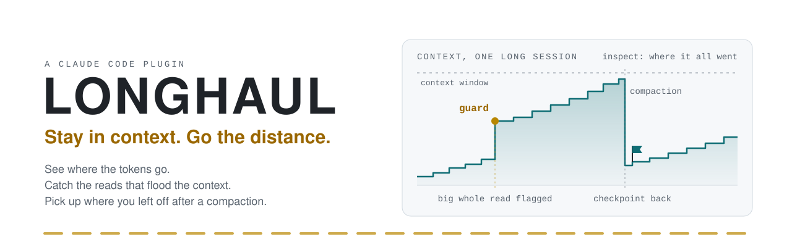

<p align="center">
  <picture>
    <source media="(prefers-color-scheme: dark)" srcset=".github/assets/longhaul-banner-dark.svg">
    
  </picture>
</p>

<p align="center">
  <a href="https://github.com/Noah-OS/longhaul/actions/workflows/tests.yml"></a>
  <a href="https://github.com/Noah-OS/longhaul/releases"></a>
  <a href="https://github.com/Noah-OS/longhaul/wiki/Installation"></a>
  <a href="LICENSE"></a>
</p>

<p align="center">
  <a href="#quick-start"><b>Quick start</b></a> &nbsp;·&nbsp;
  <a href="#what-you-get"><b>What you get</b></a> &nbsp;·&nbsp;
  <a href="#measured"><b>Measured</b></a> &nbsp;·&nbsp;
  <a href="https://github.com/Noah-OS/longhaul/wiki"><b>Wiki</b></a> &nbsp;·&nbsp;
  <a href="#releases"><b>Releases</b></a>
</p>

**Longhaul** shows where a Claude Code conversation's tokens went, flags the tool calls that put a big file into the context whole or a file the context already holds, and puts the model's own checkpoint back after a compaction or a resume. It is a Claude Code plugin and a terminal command in one Python file (plus a two-file VS Code launcher), standard library only, and what it keeps stays on your machine. The detail is in the [wiki](https://github.com/Noah-OS/longhaul/wiki).

## Why it exists

Long sessions run out of room quietly. A whole `Read` of a big file puts all of it into the context, where every later request carries it until the next compaction; a second whole read of a file that has not changed puts it there twice. Claude Code's own summary at compaction is made when the context is already full. And once a conversation is over, it is hard to say which calls its tokens went to.

Longhaul was built from those patterns as they show up in real use: in one person's 964 transcripts over five weeks, 515 whole-file reads over 20,000 characters, 17.4 million characters in all. It reports the way it asks to be judged: every number names where it came from and how sure it is, and no saving is claimed that has not been measured (see [Measured](#measured): so far, none has been shown).

## What you get

| Feature | What it does |
|---|---|
| **[Usage report](https://github.com/Noah-OS/longhaul/wiki/Usage-Report)**<br>`/longhaul:inspect`<br><sub>In the plugin</sub> | Requests and tokens by kind and by model, context growth and compactions, the largest tool outputs, searches, repeated reads, what the guard caught. Each heading names its source and how sure it is. |
| **[Context guard](https://github.com/Noah-OS/longhaul/wiki/Context-Guard)**<br><sub>On, advice only</sub> | Flags a file read again unchanged, and a whole `Read` or bare `cat` of a file over 20,000 bytes. Advice by default; denial is opt-in. |
| **[Checkpoint](https://github.com/Noah-OS/longhaul/wiki/Checkpoints)**<br>`/longhaul:checkpoint`<br><sub>In the plugin</sub> | The model saves its goal, next action, decisions and changed files; Longhaul puts them back after a compaction or a resume. |
| **[Status line and ledger](https://github.com/Noah-OS/longhaul/wiki/Usage-Report)**<br>`longhaul statusline`<br><sub>Terminal command, set by you</sub> | The account and its 5-hour and 7-day allowance with the reset times; each reading kept for `inspect` and `longhaul usage`. |
| **[Code index](https://github.com/Noah-OS/longhaul/wiki/Code-Index)**<br><sub>Note on; building opt-in</sub> | Tells the model when it finds a CodeGraph index; with `LONGHAUL_INDEX=on`, builds a CodeGraph or Trail-Code map for you. |
| **[Advisor](https://github.com/Noah-OS/longhaul/wiki/Advisor-Experiment)**<br>`/longhaul:advise`<br><sub>Experiment, off</sub> | A stronger model reviews the work at four decision points: read-only, capped and traced. |
| **[Across subscriptions](https://github.com/Noah-OS/longhaul/wiki/Account-Switching)**<br>`longhaul`<br><sub>Advanced, experimental, off</sub> | Runs `claude` in your terminal and, at a usage limit, asks before moving the conversation to another of your own subscriptions, or waits for the reset. |

## Quick start

> [!IMPORTANT]
> A plugin runs code with your privileges, and Longhaul's hooks run in every session once it is enabled. Read [what the hooks do](https://github.com/Noah-OS/longhaul/wiki/Hooks) before you install it.

**1. Install the plugin**, in Claude Code:

```
/plugin marketplace add Noah-OS/longhaul
/plugin install longhaul@longhaul
```

**2. See the report**, in any session:

```
/longhaul:inspect
```

Once the plugin is loaded (the next session, or `/reload-plugins`), the guard runs in warn mode and `/longhaul:checkpoint` saves the state when it is worth keeping.

**3. The status line** (optional) needs the terminal command. Keep a checkout, since the command links to it:

```
git clone https://github.com/Noah-OS/longhaul.git
cd longhaul
python3 longhaul.py setup
```

Then point the status line at it in your own `~/.claude/settings.json`:

```json
"statusLine": {"type": "command", "command": "~/.local/bin/longhaul statusline"}
```

You need Claude Code and `python3` on your PATH: Python 3.10 or later, nothing pip-installed. Longhaul is built and checked on macOS, and its tests pass on Linux in CI. [Installation](https://github.com/Noah-OS/longhaul/wiki/Installation) has the rest.

## Measured

> [!NOTE]
> **So far, no saving shown.** On a task where the guard had nothing to catch, block mode saved nothing; on a task where it denied reads the task needed, it cost 3.5 times the baseline's prompt tokens and four times its requests. `warn` stays the default until a week of real use is counted. The method and every number: [Measurements](https://github.com/Noah-OS/longhaul/wiki/Measurements).

## Know before you use it

- **The hooks run in every session** of every project once the plugin is enabled, and add 87–94 ms to every `Read` and `Bash` call (measured warm on one Mac). They let the call run whatever goes wrong, except the Advisor's check of a consultation. [Hooks](https://github.com/Noah-OS/longhaul/wiki/Hooks)
- **A checkpoint is not a backup.** It is the model's own summary, at most 8,000 bytes, put back after a compaction or a resume and not after `/clear`. [Checkpoints](https://github.com/Noah-OS/longhaul/wiki/Checkpoints)
- **Off unless you turn them on:** building a code index, the Advisor experiment, and switching accounts, which is experimental. [Architecture](https://github.com/Noah-OS/longhaul/wiki/Architecture)
- **Local only.** Longhaul keeps its records under `~/.longhaul`: numbers, ids and file paths, never message text or tool output, except the checkpoint, which is the model's own summary on purpose. It has no telemetry. [Privacy and security](https://github.com/Noah-OS/longhaul/wiki/Privacy-and-Security)
- Everything not covered or not yet checked: [Limitations](https://github.com/Noah-OS/longhaul/wiki/Limitations).

## Documentation

The [wiki](https://github.com/Noah-OS/longhaul/wiki) holds the detail:

- **Using it:** [Installation](https://github.com/Noah-OS/longhaul/wiki/Installation) · [Usage report](https://github.com/Noah-OS/longhaul/wiki/Usage-Report) · [Context guard](https://github.com/Noah-OS/longhaul/wiki/Context-Guard) · [Checkpoints](https://github.com/Noah-OS/longhaul/wiki/Checkpoints) · [Commands](https://github.com/Noah-OS/longhaul/wiki/Commands)
- **How it works:** [Architecture](https://github.com/Noah-OS/longhaul/wiki/Architecture) · [Hooks](https://github.com/Noah-OS/longhaul/wiki/Hooks) · [Code index](https://github.com/Noah-OS/longhaul/wiki/Code-Index) · [Advisor experiment](https://github.com/Noah-OS/longhaul/wiki/Advisor-Experiment) · [Account switching](https://github.com/Noah-OS/longhaul/wiki/Account-Switching)
- **What to trust:** [Measurements](https://github.com/Noah-OS/longhaul/wiki/Measurements) · [Privacy and security](https://github.com/Noah-OS/longhaul/wiki/Privacy-and-Security) · [Limitations](https://github.com/Noah-OS/longhaul/wiki/Limitations) · [Roadmap](https://github.com/Noah-OS/longhaul/wiki/Roadmap)

## Releases

**0.1.0** (2026-10-21) is the only release: [release notes](https://github.com/Noah-OS/longhaul/releases/tag/v0.1.0) · [changelog](CHANGELOG.md). The default branch has moved on since and still reads 0.1.0; installing from the marketplace takes it as it stands. What has landed since: [Roadmap](https://github.com/Noah-OS/longhaul/wiki/Roadmap#releases).

## Development

The tests ship with the code. From a checkout:

```
S=$(mktemp -d); LONGHAUL_HOME=$S/home LONGHAUL_DEFAULT_CONFIG_DIR=$S/claude LONGHAUL_DEFAULT_GLOBAL_JSON=$S/claude.json LONGHAUL_NO_NOTIFY=1 python3 -m unittest test_longhaul -q
```

The scratch paths keep the tests away from your real `~/.claude` and `~/.longhaul`, and the suite runs on two fakes of Claude Code, so no `claude` is needed. [CI](.github/workflows/tests.yml) runs that command on every push and pull request, on macOS and Linux, on Python 3.10 and the latest 3.x, and checks the plugin with `claude plugin validate --strict .`. Questions and bug reports go to the [issue tracker](https://github.com/Noah-OS/longhaul/issues).

## Licence

MIT. See [LICENSE](LICENSE).
