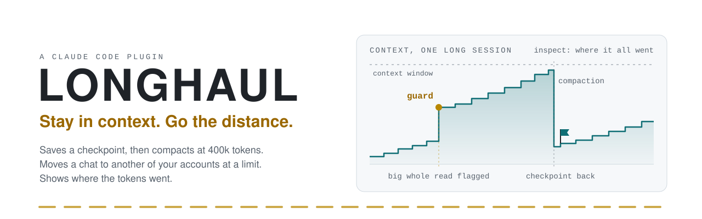

<p align="center">
  <picture>
    <source media="(prefers-color-scheme: dark)" srcset=".github/assets/longhaul-banner-dark.svg">
    
  </picture>
</p>

<p align="center">
  <a href="https://github.com/Noah-OS/longhaul/actions/workflows/tests.yml"></a>
  <a href="https://github.com/Noah-OS/longhaul/releases"></a>
  <a href="https://github.com/Noah-OS/longhaul/wiki/Installation"></a>
  <a href="LICENSE"></a>
</p>

<p align="center">
  <a href="#1-install"><b>Install</b></a> &nbsp;·&nbsp;
  <a href="#3-day-to-day"><b>Day to day</b></a> &nbsp;·&nbsp;
  <a href="#4-more-than-one-account"><b>Accounts</b></a> &nbsp;·&nbsp;
  <a href="#6-codex"><b>Codex</b></a> &nbsp;·&nbsp;
  <a href="#troubleshooting"><b>Troubleshooting</b></a> &nbsp;·&nbsp;
  <a href="https://github.com/Noah-OS/longhaul/wiki"><b>Wiki</b></a>
</p>

**Longhaul** is a Claude Code plugin for long sessions and for more than one account. At 400,000 tokens of context it has Claude save a checkpoint, then compacts the chat, so a long session stops carrying its whole history into every request. With more than one of your own Claude subscriptions, at a usage limit it asks, then moves the chat to another one or carries it on by itself when the limit resets. It shows where a conversation's tokens went. Every measurement of its features is published, the ones that showed no gain included: the checkpoint helps Claude recall a little more after a compaction, and was not shown to make the work after it better ([Measured](#measured)). It is a terminal command too, in one Python file, standard library only, and what it keeps stays on your machine.

This page is the guide: install it, check it, use it day to day, and set up the parts you want. The detail is in the [wiki](https://github.com/Noah-OS/longhaul/wiki).

> [!IMPORTANT]
> A plugin runs code with your privileges, and Longhaul's hooks run in every session once it is enabled. Read [what the hooks do](https://github.com/Noah-OS/longhaul/wiki/Hooks) before you install it.

## 1. Install

You need Claude Code and `python3` on your PATH: Python 3.10 or later, nothing pip-installed. Longhaul is built and checked on macOS, and its tests pass on Linux in CI.

**In Claude Code in a terminal:**

```
/plugin marketplace add Noah-OS/longhaul
/plugin install longhaul@longhaul
```

**In the VS Code panel:** type `/plugins`, add `Noah-OS/longhaul` in the **Marketplaces** tab, then install Longhaul from the **Plugins** tab with **Install for you**. Or open this link in VS Code, which takes you to the same choice:

```
vscode://anthropic.claude-code/install-plugin?plugin=longhaul&marketplace=Noah-OS/longhaul
```

The plugin loads in the next session, or after `/reload-plugins` in a running one.

## 2. Check it

**Try it in a minute**, in any chat, right after installing:

1. `/longhaul:checkpoint`. Claude writes down the goal, the next step, the facts it found and the files it changed.
2. `/clear`. Longhaul says "your checkpoint from before /clear is back" (in the same folder, up to 6 hours after the save). After a compaction it comes back the same way.
3. Ask "where were we?". Claude answers from the checkpoint.
4. `/longhaul:inspect` shows where this chat's tokens went. The report starts with three lines in short, which Claude tells you in its own words; each number says where it came from, and ≈ marks an estimate. For a chat that read one file three times:

   ```
   In short [transcript, from the sections below; ≈ marks tokens estimated as characters / 4]
     30 requests [counted]; context peak 129,002 tokens, compacted once: 412,000 -> 21,000 [measured]
     Cache reads: 97% of the tokens [measured]; the most tool output: Read, ≈41,375 tokens [estimated]
     Worth a look, Read again: /code/app/f1.py, 2 more times, ≈16,250 tokens [inferred]
   ```

**What is set up**, in any chat:

```
/longhaul:doctor
```

Its first line says how many things are to fix, or "nothing to fix". Then it groups its checks under **To fix**, **Working now**, **Worth adding** and **Not for you right now**, one line each with ✔, ✘ or ⚠, and ends with the next step. It checks the plugin, the terminal command, Claude Code, updates, the status line, the VS Code panel, your accounts, the chats running now, the code maps (and Trail-Code's hooks left with no map), the hooks and their measured time, the features, and Codex. It only reads.

**The terminal command** (optional, but most of this guide uses it). Installing the plugin does not create it. `/longhaul:doctor` gives the exact line to run under *Terminal command*, such as:

```
python3 ~/.claude/plugins/cache/longhaul/longhaul/<version>/longhaul.py setup
```

It writes `~/.local/bin/longhaul`, a short launcher that runs the newest Longhaul Claude Code has installed, so it keeps working after each update. Then `longhaul doctor` works in a terminal too. If the shell says `longhaul: command not found`, see [Troubleshooting](#troubleshooting).

**The status line** (optional): `longhaul statusline install` shows one line under Claude Code's prompt, in the same words as the VS Code panel's status entry: the account first, then its 5-hour and weekly allowance and the context, as in `work · 5h 91% (14:00) · wk 40% · ctx 88k` (a reset time once a window is 70% used). When something is going on, the line says that instead, one thing at a time: `personal at limit · move to work? /accounts`, `personal at limit · carries on 14:01 on work`, `personal at limit until 14:00 · stopped · /accounts`, `work (moved from personal 11:52)` for an hour after a move, `personal · → work after this turn` for a choice made with `longhaul use`, or `personal · message stopped: ~/clients is work's · /accounts`. `update 0.3.9` comes last when a newer Longhaul is out (from the daily check in step 8: nothing more is sent). The default sign-in (`~/.claude`, which no account of yours names) shows as `default sign-in`, as it does everywhere. It keeps each reading for `/longhaul:inspect` and `longhaul usage`. It backs up your `settings.json`, asks before replacing a status line you already have, and checks the command runs; `longhaul statusline uninstall` puts the old one back.

## 3. Day to day

Once the plugin is loaded, most of it works by itself.

**What runs by itself**

| | What it does |
|---|---|
| **[Context guard](https://github.com/Noah-OS/longhaul/wiki/Context-Guard)**<br><sub>On, advice only</sub> | Tells Claude when a whole `Read` or bare `cat` would put a file over 20,000 bytes into the context, or a file it already read and that has not changed since. Advice by default (`LONGHAUL_GUARD=block` denies instead). It also tells a subagent whose Bash call could outlast its 5-minute prompt cache to run it in the background and check back. |
| **The context reminder and the compaction** | At 400,000 tokens of context Claude is asked to save a checkpoint at its next stopping point; once it has, Longhaul compacts the chat at the end of that turn (`LONGHAUL_AUTO_COMPACT=off` turns that off), and the checkpoint comes back. A subagent whose own context passes 150,000 tokens is told to finish its step and report what is done and what is left (`LONGHAUL_SUBAGENT_AT` sets the size; `off` turns it off). |
| **Auto Model**<br><sub>On, a guide</sub> | At each start Claude gets a short guide for choosing each subagent's model by how hard its job is, and every pick is logged. `longhaul models off` turns it off; `longhaul models cap sonnet` lowers a call above Sonnet. Its effect on cost and quality is not measured yet. |
| **Output filter**<br><sub>Off</sub> | Shortens a long `Bash` output where nothing is lost (`LONGHAUL_FILTERS=lossless`), or more (`on`). Off by default: in a week of shadow measuring it would have cut 0.35% of Bash output (`lossless`) or 1.24% (`on`), not worth a hook on every long output. `shadow` measures without changing anything. |
| **[Code index](https://github.com/Noah-OS/longhaul/wiki/Code-Index)**<br><sub>On</sub> | Where CodeGraph is installed and the repository has no map, builds one in the background, and tells Claude when an index exists. `LONGHAUL_INDEX=all` adds Trail-Code; `LONGHAUL_INDEX=off` turns it off. Longhaul installs nothing. For a lesson a session should not repeat, one line in the project's `CLAUDE.md` worked as well as Trail-Code's saved lesson, for less ([measured](https://github.com/Noah-OS/longhaul/wiki/Code-Index)). |
| **Display**<br><sub>In Claude Code and the VS Code panel</sub> | A status entry in the status line's words: the account, its allowance and the context, or what is going on (a question at a limit, a carry-on, a move, a stopped message), then `update 0.3.9` when a newer Longhaul is out. A pop-up when a checkpoint is saved or brought back, the reminder fires, the account changes at a limit, a question at a limit waits in `/accounts`, a turn stops at a limit or on a sign-in or billing error, or a newer Longhaul is out. |

**What you type in a chat**

| Command | When to use it |
|---|---|
| `/longhaul:checkpoint` | Before a compaction, at the end of a step, or before you stop. Claude writes the goal, the next action, your own words, the facts it found, the decisions and why, what failed and the files it changed; Longhaul puts it back after a compaction, a resume, or a `/clear` in the same folder within 6 hours. |
| `/longhaul:inspect` | To see where a conversation's tokens went: three lines in short first (what it was, where most of the tokens went, and the one finding worth a look), then requests and tokens by kind and model, subagents, context growth and compactions, what the cache cost, the largest tool outputs, searches, repeated reads, what the guard caught, and each hook's measured time. Every number says where it came from. |
| `/longhaul:doctor` | To see what is set up and what to do next. |
| `/accounts` | To see your accounts and manage them with buttons: see [More than one account](#4-more-than-one-account). |
| `/longhaul:manage` | To set Longhaul up without a terminal, in your own words: see [From the VS Code chat](#5-from-the-vs-code-chat). |

**Keeping a long session on track:** let the reminder ask for the checkpoint, or type `/longhaul:checkpoint` yourself, then `/compact` or `/clear`; the work picks up from the checkpoint. Instructions to `/compact` kept no more in a test of 8 real compactions, so Longhaul does not suggest them ([Measurements](https://github.com/Noah-OS/longhaul/wiki/Measurements)).

**What Longhaul did by itself, and why:** `longhaul activity` in a terminal lists today's decisions from Longhaul's log: the account a chat started on and why, a move at a limit or while idle, a message stopped in a folder kept for another account, a recorded limit forgotten, a question or a carry-on at a limit, a `longhaul use` choice, a checkpoint saved or put back, a compaction, a repair, a pause in the panel. The chat it runs in (or `--chat ID`) comes first, then the others. `--days 7` goes back a week; `--json` gives the events as JSON. It shows ids, account names, folders and times, never a word of a chat, and its last line names the full log. In `/accounts`, **Activity** shows the same, with **Earlier days** for the last week, then the last month.

## 4. More than one account

Longhaul can run your chats across several of your own Claude subscriptions. Each account is its own claude.ai sign-in, in its own folder. This is advanced and experimental; it is off until you add a second account.

**With one subscription** there is no list of accounts: Claude Code's own sign-in, in `~/.claude`, is the **default sign-in**, and every screen calls it that: `/accounts` (its page says "default sign-in (~/.claude)"), `longhaul status`, the status line, the doctor, `longhaul activity` and the notifications at a limit. Its page offers no Sign in, Remove or folders, which only an account on the list has; to sign it in again, use `/login` in Claude Code. `longhaul clear` forgets its recorded limit. In Longhaul's own files and in commands it is keyed `main`, as the status line always kept it; Longhaul 0.3.20 and earlier called it "Max", and a limit or a log line recorded under that name is still read as the default sign-in's.

**See your accounts:** type `/accounts` in a chat, in the terminal or in the VS Code panel. It opens a list, as `/mcp` does:

- above them, why this chat runs on its account, when Longhaul's log says (for example "This chat: work. Why: ~/clients prefers work, and it had room.");
- a row per account: its plan, its sign-in, its week's use or its limit, then, on a line under it, where it may be used (its folders by name, or by their number where they do not fit 80 columns), whether it is the fallback, and "capped until Fri 02:00" while it is at its cap;
- `+ Add account`;
- `Activity`: what Longhaul did by itself today, and why, this chat first (see [Day to day](#3-day-to-day));
- `Settings`: what a chat does at a usage limit (**Ask me first**, **Move automatically** or **Stay and wait**), with what this chat would do now and where that choice is set; the VS Code panel on or off; and forgetting the recorded limits.

Use the arrow keys to move and Enter to open a line. Escape, or **Back**, goes back to the list; Escape on the list closes it. An account's page shows its 5-hour and week use, its folder and its email, masked (`y…@example.com`). On the phone, `/accounts` shows the list only. In a terminal, `longhaul status` lists the accounts too.

**Add an account.** In `/accounts`: open `+ Add account`, type the name and the email (and, if you want, the folders it may be used in), then press **Add account**. Or in a terminal:

```
longhaul add work you@example.com
```

Either way, the browser sign-in opens at once: sign in with that same email. What you type in `/accounts` goes to Longhaul's own command, not to Claude, and a password or a code is typed only in the browser.

**Sign in again, or remove an account.** In `/accounts`, open the account's line: **Sign in again** (or **Sign in**), or **Remove**, which asks first; its **Remove and delete its sign-in folder…** then shows what the delete would take, in the terminal's words below, and asks again. In a terminal: `longhaul setup work --relogin` signs it in again; `longhaul remove work` takes it off the list. Its folder and sign-in stay. `longhaul remove work --delete-folder` deletes its folder too, with the sign-in and any chat history kept in it, for good: it says what goes and asks first, and refuses `~/.claude`, a folder another account uses and one a chat still runs on. `longhaul remove work --delete-folder --dry-run` says the same (the folder, its size, how many conversations are kept in it, or that its history is only linked into `~/.claude` and so stays) and changes nothing. On a Mac the sign-in Claude Code keeps in the Keychain may remain. `longhaul doctor` names the `~/.claude-*` folders no account uses.

**A failed sign-in.** When a chat stops because its sign-in failed, Longhaul marks that account. `/accounts` shows "sign-in failed" on its line, and its page offers **Sign in**. `longhaul status` gives the line to run: `longhaul setup NAME --relogin`. The mark goes at the account's next reply, or after a sign-in that works.

**Use them in the VS Code panel:** `longhaul vscode on` (or `/accounts`, then `Settings`), then reload VS Code (Cmd+Shift+P, then *Developer: Reload Window*). `longhaul vscode off` puts the panel back on its own sign-in.

**At a usage limit**, the switching mode decides (`longhaul switch` shows it; `longhaul switch ask`, or `/accounts`, then `Settings`, sets it):

| Mode | At a limit |
|---|---|
| `ask`, **Ask me first** in `/accounts` (the default) | Asks before it moves the chat to another account: in a terminal `longhaul`, in that terminal; in the VS Code panel, in `/accounts` (below). When every account is at its limit, it offers to carry on with the first one to reset. It never moves a chat early. |
| `auto`, **Move automatically** | Moves the chat to an account with room, and early, while the chat is idle, when one is nearly full. When every account is at its limit, it carries on with the first one to reset, without asking. |
| `never`, **Stay and wait** | Waits for the reset, and carries on with the same account. |

**In the VS Code panel, in `ask`**, for example with two accounts named Max and Pro. There is nothing to set: Longhaul stays in each panel chat to ask and to carry on.

1. At the limit, Longhaul tries to open `/accounts` with a question at the top. If it does not open, a pop-up says so: type `/accounts`.
2. "Max hit its weekly limit (resets Fri 02:00). Move this chat to Pro and carry on?" Press **Move and carry on**, or **Wait, carry on at 02:01**.
3. When every account is at its limit: "Every account is at its limit. Pro resets first, at 14:00. Carry on there then?" **Yes, carry on at 14:01** carries on by itself a minute after that reset. **No** leaves the chat as it is.

A chat you reopen (after a VS Code reload, or with its tab reopened) on an account that is at its limit asks at once, before your first message. What you type meanwhile waits for your answer: **Move and carry on** sends it on Pro; **Wait, carry on at …** lets it through, where it gets the limit's answer, and carries on by itself after the reset. With no answer, nothing moves: what you typed goes on there once the limit resets.

With no answer, nothing moves. If the chat carried on first (Claude Code's own wait, or a message from you), Longhaul sends nothing. While a question waits, the status entry says `Max at limit · move to Pro? /accounts`; while a carry-on waits, `Max at limit · carries on 14:01 on Pro` (a minute after the reset, to be safe).

Longhaul stays in each panel chat in every mode. To turn that off, run `longhaul panel pause` in a terminal, or press **Pause Longhaul in panel chats** on the **Troubleshoot** page of `/accounts`. The panel then runs Claude alone: at a limit there is no question, no carry-on and no move. `longhaul panel resume` (or **Resume Longhaul in panel chats**) turns Longhaul back on, and `longhaul panel` says which is in force. Each counts for the chats you open after it. Both write `"switch_mid_session"` in `~/.longhaul/vscode.json` and keep the file's other keys.

A `"switch"` key in `~/.longhaul/vscode.json` gives the panel a mode of its own; `/accounts`, then `Settings`, says so.

**Keep a folder for one account:** `longhaul add work you@example.com --repo ~/work` uses that account only in `~/work` and the repositories inside it, and keeps the folder for it: a chat there on another account is refused before anything is sent. When the account kept for a folder is at its limit, `longhaul` in a terminal asks whether to run the chat on another one; `longhaul allow <chat id>` lets one refused chat's prompts through on its account for 30 days.

**Change an account's folders.** In `/accounts`, open the account: its Folders part lists them, each with **Remove**; type a folder and press **Add folder**, or press **Remove all folder limits…** to drop the list. Each of these says first what it would do, from the `--dry-run` below (which folders would then refuse a chat on which account, and which chats it would stop), and runs only after a yes. In a terminal, `longhaul folders work` says where `work` may be used; `longhaul folders work --add ~/clients` adds a folder, `--remove ~/work` takes one off, and `--anywhere` drops the list. To see a change before making it, add `--dry-run` (`longhaul folders NAME ... --dry-run`): it says where the account may then be used, which folders would then refuse a chat on which account, and which chats running now or started in the last 7 days it would stop or move, and it changes nothing. An account with no folders of its own is used only where no other account's folders reach: beside an account whose folders include `/`, it is used nowhere until it has folders of its own, and `/accounts`, `longhaul status` and `longhaul folders` say so.

**Choose the account for one chat.** `longhaul use work --chat <chat id>` runs that chat on `work` from now on (a short id works when only one chat starts with it; run from inside a chat, `longhaul use work` needs no `--chat`). A chat in the VS Code panel moves the next time Claude is idle in it, with a line in the chat saying so; any other chat (closed, in a terminal, or with Longhaul paused in panel chats) starts on `work` when it is next opened, and the command says which. It refuses an account not allowed in the chat's folder, one at its usage limit, or one not signed in as expected. A choice is no lock: at a usage limit the switching mode decides, as for any chat.

**Prefer an account in a folder.** `longhaul folders work --prefer ~/clients` makes `work` the first choice for a new chat in `~/clients` or a folder inside it, and for a chat there that moves at a usage limit, while `work` has room (the deepest preferred folder wins); `--no-prefer ~/clients` takes it off, and `longhaul folders work` and `longhaul status` show it. When `work` is at its limit, nearly full, or not signed in, the usual rules pick. A reopened chat goes back to the account it ran on; `longhaul use` moves that one. A folder `work` may not be used in is refused, with why.

**Keep an account as a fallback.** In `/accounts`, open the account and press **Use as fallback**; in a terminal, `longhaul fallback work on` (`off` makes it a normal account again; `longhaul add NAME EMAIL --fallback` marks a new one). A fallback is used only when no other account allowed in that folder has room: at a limit the chat moves to a normal account first, the early move never goes to it, and a chat already on it stays there.

**What the accounts share.** Your history, memory, settings, skills, plugins and MCP servers are one set for every account. An MCP server added, changed or removed on any account (`claude mcp add`, `claude mcp remove`), user-scope or a folder's own, reaches all of them before the next chat starts. Sign-ins to remote servers (OAuth via `/mcp`) and claude.ai connectors stay per account, as Claude Code keeps them.

**Use only part of an account.** A cap is the share of an account's usage Longhaul lets your chats take: one number, for both its 5-hour window and its weekly one. In a terminal:

```
longhaul cap work 25
```

`work` is then used up to 25% of each window. Once either window reaches 25%, `work` is treated as if it were at its limit until that window resets: no new chat starts on it, and a chat on it leaves it between turns, while Claude is idle and no background agent works, by the switching mode: `auto` moves it to an account with room, with no message in the chat, since nothing was cut off; `ask` asks first ("work is at its cap (25%) until Fri 02:00. Move this chat to personal now?", in `/accounts` with **Move now** and **Wait for the reset (Fri 02:00)**); `never` holds your next message until the reset. When every account is at its cap or its limit, the chat waits for the first one to reset, as at a limit. `longhaul cap work 50` raises it and `longhaul cap work off` removes it, and either frees the account at once; `longhaul cap` lists each account's cap and where it stands now. In `/accounts`, an account's page says "Cap: 25% (now 18% of its week)", by the window used the most, "Cap: 25%, at it until Fri 02:00 (in 2 d 4 h), now 30% of its 5 hours" while it is at it, or "Cap: none", with a button for each of 25, 50 and 75% and none that is not its cap now, and offers no **Use for this chat** while it is at its cap; `longhaul status` and the doctor say it too. In the VS Code panel, a message held for a cap waits in the panel and goes at the reset, or as soon as you move the chat or change the cap; a notification says when, and how to send it sooner.

The limits, honestly: the cap is checked from the status line's reading, written after each request, so a long turn can pass it by a little before the chat leaves; a capped account waits for its window's reset, which can be days for the weekly one; and the default sign-in with no list of accounts has no cap.

**From a terminal**, `longhaul` starts a chat (`-c` continues the latest, `-r <id>` resumes one) that it watches and moves at a limit. A chat moved to another account takes that account's connectors and artifacts, not the first one's. [Account switching](https://github.com/Noah-OS/longhaul/wiki/Account-Switching) has the rest.

## 5. From the VS Code chat

**With buttons:** type `/accounts`. It adds, signs in again and removes accounts; in `Settings` it sets switching, turns the VS Code panel on or off, and forgets the recorded limits; in `Troubleshoot` it fixes what is stuck and pauses Longhaul in panel chats ([More than one account](#4-more-than-one-account)). It runs Longhaul's own commands: no email, password or code goes through the chat. At a usage limit in `ask`, its question is where you answer.

**In words:** ask in your own words, for example "add my work account", "turn on the panel" or "set switching to ask". `/longhaul:manage` shows the exact command and what it changes, and runs it only after your yes in the chat. From a chat it can:

- add, sign in again or remove an account, with its folder too if you say so (the sign-in opens in your browser; never type a password or code into the chat);
- change where an account may be used or is preferred (`longhaul folders`), and choose the account this chat runs on (`longhaul use`);
- set the switching mode and the subagent models;
- turn the VS Code panel's use of your accounts on or off;
- install or remove the status line, and turn Claude Code's auto-update for Longhaul on or off;
- forget the recorded limits, or one account's (`longhaul clear NAME`), allow a refused chat (`longhaul allow`), and uninstall (with `--purge` only after it says that this deletes `~/.longhaul`).

What stays in a terminal: starting a chat with `longhaul`, the trials, and the Advisor's probe record. The fallback mark and the cap change with the buttons in `/accounts`, or `longhaul fallback` and `longhaul cap` in a terminal, not from `/longhaul:manage`. The question at a limit is yours to answer, with the buttons in `/accounts`: they run `longhaul answer`, which the plugin refuses to run for a chat's Claude.

## 6. Codex

Longhaul works in OpenAI's Codex too. In a terminal:

```
codex plugin marketplace add Noah-OS/longhaul
codex plugin add longhaul@longhaul
```

Then start `codex`, open `/hooks` and trust Longhaul's hooks (newer Codex versions ask again after each update; `longhaul doctor` says how many are trusted). In Codex you get the checkpoint (`$longhaul:checkpoint`, put back after a compaction, a resume or a clear), the context reminder, the guard, the output filter in shadow, and a log of each sub-agent's model. `longhaul inspect --agent codex`, `longhaul usage` and `longhaul doctor` read Codex's chats and settings from the terminal.

Codex does not get the status line, the display's pop-ups, Longhaul's own compaction (Codex compacts by itself, at 90% of the model's window), the Advisor, or lowering a sub-agent's model. A checkpoint save writes `~/.longhaul`, outside the project, so Codex's sandbox asks once per save; `longhaul doctor` gives the line to paste into Codex's `config.toml` to let it through (Longhaul never writes it). Codex compresses a chat after a week: where Python's standard library has no `compression.zstd`, those are counted, not read.

## 7. Settings

The switches are environment variables, read at each hook and command; `longhaul status` names any set to a value it can't use (that one keeps its default).

| Setting | Default | What it changes |
|---|---|---|
| `LONGHAUL_GUARD` | `warn` | `block` denies the reads it flags; `off` does nothing |
| `LONGHAUL_CHECKPOINT_AT` | `400000` (`200000` in Codex) | tokens of context at which Claude is asked to save; `off` |
| `LONGHAUL_AUTO_COMPACT` | on | `off`: no compaction after a save |
| `LONGHAUL_SUBAGENT_AT` | `150000` | a subagent's own context at which it is told to report back; `off` |
| `LONGHAUL_FILTERS` | `off` | `shadow` (measures only), `lossless` or `on` |
| `LONGHAUL_INDEX` | on | CodeGraph's index only; `all`: CodeGraph's and Trail-Code's; `off`: no code index built |
| `LONGHAUL_SWITCH` | `ask` | `auto` or `never`; overrides `longhaul switch` |
| `LONGHAUL_API_RETRY` | on | `off`: no carry-on in the VS Code panel a minute after a turn stopped on an API server error |
| `LONGHAUL_LOG` | routine lines left out | `debug`: every line, reminder checks below the threshold and short panel jobs included |
| `LONGHAUL_UPDATE_CHECK` | on | `off`: no daily release check, and no `update` word in the status line |
| `LONGHAUL_PLAIN` | off | `1`: words for a screen reader where Longhaul draws marks: OK, Failed and Warning first in place of ✔ ✘ ⚠, `, ` in place of ` · `, and no `›` on the focused line; in `/accounts`, `longhaul doctor`, `longhaul status` and the status line |

`longhaul models [guide|on|off|cap MODEL]` sets Auto Model. The full list of commands: `longhaul help all` (`longhaul -h` shows the usual ones on one screen), or [Commands](https://github.com/Noah-OS/longhaul/wiki/Commands).

## 8. Update and remove

Longhaul asks GitHub once a day, in the background, whether a newer release is out, and says so when a session starts; the request sends nothing but Longhaul's version number, and `LONGHAUL_UPDATE_CHECK=off` turns it off. To update: `claude plugin marketplace update longhaul`, then `claude plugin update longhaul@longhaul` (and `longhaul-advisor@longhaul` where it is installed), then `/reload-plugins` in a running chat. Claude Code's own auto-update is off by default for a marketplace like Longhaul's: `longhaul update on` turns it on, after asking (or `/plugin` > Marketplaces > Enable auto-update), and `longhaul update` shows the versions.

To remove it: `longhaul uninstall --dry-run` lists what Longhaul put outside the plugin (its status line, the VS Code panel's line, the auto-update entry, the terminal command), and `longhaul uninstall` removes them after a yes, putting back what was there before; `--purge` also removes `~/.longhaul`. Then `claude plugin uninstall longhaul@longhaul`.

## Troubleshooting

- **`longhaul: command not found`.** The command is not set up yet: run the line `/longhaul:doctor` gives under *Terminal command* (step 2). If it is still not found, `~/.local/bin` is not on your PATH: add `export PATH="$HOME/.local/bin:$PATH"` to `~/.zshrc` (or `~/.bashrc`) and open a new terminal.
- **A chat says a folder "is kept for" another account.** Open it again on that account (`longhaul -r <id>`), or allow it on its own: `longhaul allow <id>` in a terminal, or ask Claude in another chat to run it.
- **The VS Code panel ignores your accounts.** Run `longhaul vscode on`, then reload VS Code.
- **A chat stopped because its sign-in failed.** In `/accounts`, open that account and press **Sign in**, or run `longhaul setup NAME --relogin` in a terminal; then send a message.
- **A pop-up says a question waits, and nothing opened.** Type `/accounts`: the question is at the top.
- **A chat open twice**, in a terminal and in the panel, writes the same conversation from two places: close one. Longhaul says so when it notices.
- **Something seems stuck** (a chat that waits for nothing, a question no one can answer, an `accounts.json` that will not read): `longhaul repair --dry-run` lists what is stuck and what each fix does, and changes nothing; `longhaul repair` in a terminal asks before each fix, and `longhaul repair --fix ID` makes one alone (`--json` gives each one's id). In `/accounts`, **Troubleshoot** lists the same, each with **Fix**, which asks first. No need to uninstall to start over. From 0.3.13 on, each change to the account list keeps the last good copy as `~/.longhaul/accounts.json.last-good`, which `repair` can put back.
- **Anything else:** `/longhaul:doctor`, then the [issue tracker](https://github.com/Noah-OS/longhaul/issues).

## Know before you use it

- **The hooks run in every session** of every project once the plugin is enabled, and add 87–94 ms to every `Read` and `Bash` call (measured warm on one Mac); `/longhaul:inspect` shows each hook's measured time, and `longhaul doctor` Longhaul's own. They let the call run whatever goes wrong, except the Advisor's check of a consultation. [Hooks](https://github.com/Noah-OS/longhaul/wiki/Hooks)
- **It adds about 509 tokens to every session's context**, its four skills' descriptions (estimated with `claude plugin details`). The Advisor's own plugin, `longhaul-advisor`, adds about 291 more where it is installed.
- **A checkpoint is not a backup.** It is the model's own summary, at most 16,000 bytes, of which about 9,000 characters come back, most needed first. [Checkpoints](https://github.com/Noah-OS/longhaul/wiki/Checkpoints)
- **Local only.** Longhaul keeps its records under `~/.longhaul`: numbers, ids and file paths, never message text or tool output, except the checkpoint, which is the model's own summary on purpose, and, with `LONGHAUL_FILTERS=on`, the whole output of a command it shortened, kept for 7 days so Claude can read the rest. Of Codex it reads only the chats under `sessions/` (numbers, names and the paths of files read, never what was said) and the few settings `longhaul doctor` names in `config.toml`, never `auth.json`. It has no telemetry. [Privacy and security](https://github.com/Noah-OS/longhaul/wiki/Privacy-and-Security)
- **[Advisor](https://github.com/Noah-OS/longhaul/wiki/Advisor-Experiment)**, an experiment in its own plugin (`longhaul-advisor`), is off: a stronger model would review the work at four decision points.
- Everything not covered or not yet checked: [Limitations](https://github.com/Noah-OS/longhaul/wiki/Limitations).

## Measured

> [!NOTE]
> Measured on one person's work, the author's.
> - **Helped a little:** over three runs on 8 real compactions, Claude recalled about 3 points more of the tested facts with the checkpoint than without (+5.9, +2.8 and +2.6; for example 72% against 66%). That is recall, not a better result on the task after. Telling `/compact` what to keep added nothing measurable.
> - **Did not make the work better:** on 8 synthetic tasks, the work after a compaction passed its hidden tests in all 24 runs without the checkpoint and in 23 of 24 with it, with about 17% more input tokens. Claude Code's own memory, on by default, had kept the plan in both.
> - **Did not help:** the guard's block mode (3.5 times the baseline's prompt tokens where it denied reads the task needed), the output filter (0.35% to 1.24% of Bash output) and the code index (no fewer tokens). Block mode and the filter are off by default.
> - **Costs:** about 90 ms on every `Read` and `Bash` call, and about 509 tokens in every session.
>
> The method and every number: [Measurements](https://github.com/Noah-OS/longhaul/wiki/Measurements).

Longhaul was built from patterns in real use: in one person's 964 transcripts over five weeks, 515 whole-file reads over 20,000 characters, 17.4 million characters in all. Every number it reports names where it came from and how sure it is, and no saving is claimed that has not been measured.

## Documentation

The [wiki](https://github.com/Noah-OS/longhaul/wiki) holds the detail:

- **Using it:** [Installation](https://github.com/Noah-OS/longhaul/wiki/Installation) · [Usage report](https://github.com/Noah-OS/longhaul/wiki/Usage-Report) · [Context guard](https://github.com/Noah-OS/longhaul/wiki/Context-Guard) · [Checkpoints](https://github.com/Noah-OS/longhaul/wiki/Checkpoints) · [Commands](https://github.com/Noah-OS/longhaul/wiki/Commands)
- **How it works:** [Architecture](https://github.com/Noah-OS/longhaul/wiki/Architecture) · [Hooks](https://github.com/Noah-OS/longhaul/wiki/Hooks) · [Code index](https://github.com/Noah-OS/longhaul/wiki/Code-Index) · [Advisor experiment](https://github.com/Noah-OS/longhaul/wiki/Advisor-Experiment) · [Account switching](https://github.com/Noah-OS/longhaul/wiki/Account-Switching)
- **What to trust:** [Measurements](https://github.com/Noah-OS/longhaul/wiki/Measurements) · [Privacy and security](https://github.com/Noah-OS/longhaul/wiki/Privacy-and-Security) · [Limitations](https://github.com/Noah-OS/longhaul/wiki/Limitations) · [Roadmap](https://github.com/Noah-OS/longhaul/wiki/Roadmap)

## Releases

Every release's notes: [Releases](https://github.com/Noah-OS/longhaul/releases) · [changelog](CHANGELOG.md). What is planned next: [Roadmap](https://github.com/Noah-OS/longhaul/wiki/Roadmap#releases).

## Development

The tests ship with the code. From a checkout:

```
S=$(mktemp -d); LONGHAUL_HOME=$S/home LONGHAUL_DEFAULT_CONFIG_DIR=$S/claude LONGHAUL_DEFAULT_GLOBAL_JSON=$S/claude.json LONGHAUL_NO_NOTIFY=1 python3 -m unittest test_longhaul -q
```

The scratch paths keep the tests away from your real `~/.claude` and `~/.longhaul`, and the suite runs on two fakes of Claude Code, so no `claude` is needed. [CI](.github/workflows/tests.yml) runs that command on every push and pull request, on macOS and Linux, on Python 3.10 and the latest 3.x, and checks both plugins with `claude plugin validate --strict` (`.` and `plugins/longhaul-advisor`). To work on Longhaul itself, a `git clone` and `python3 longhaul.py setup` link the terminal command to your checkout.

## Licence

MIT. See [LICENSE](LICENSE).
